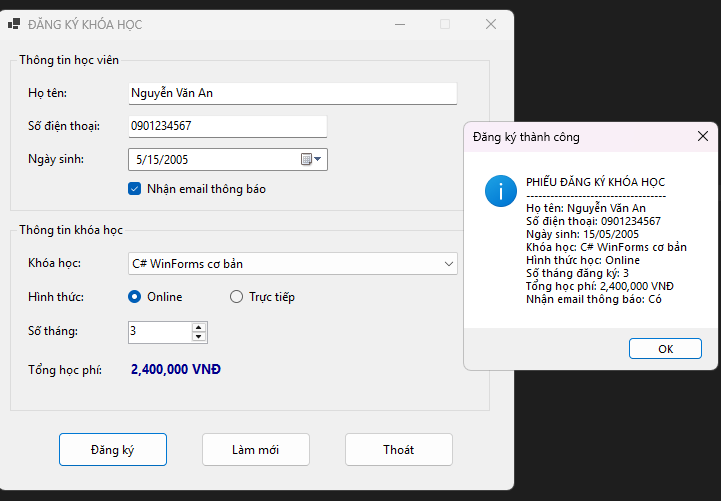
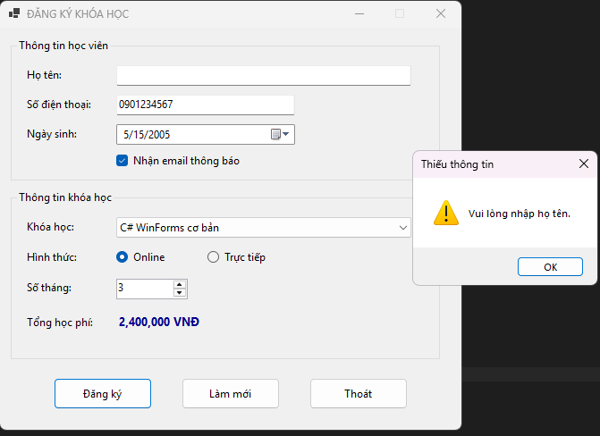
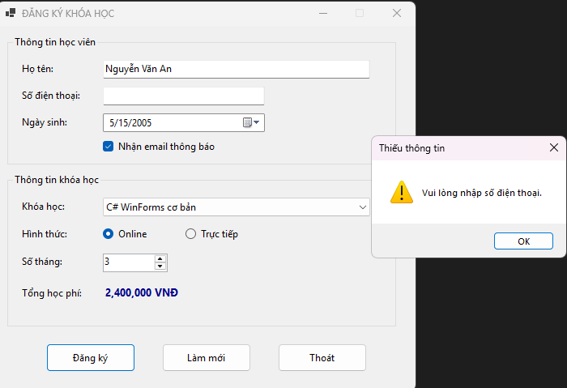
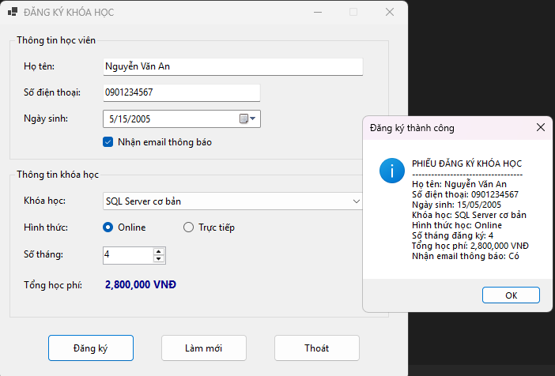
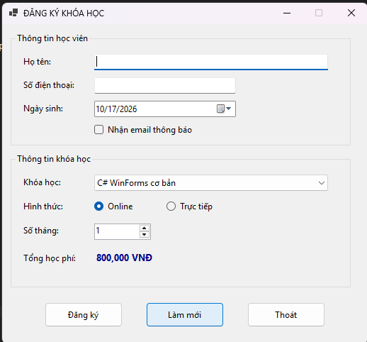
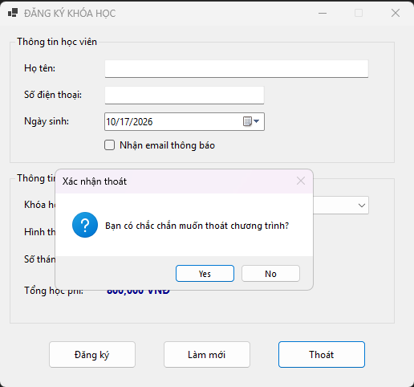

# COMP1019 - Lập trình trên Windows

## Lab 05 - Windows Forms cơ bản: Đăng ký khóa học

## 1. Giới thiệu

Bài Lab 05 giúp sinh viên làm quen với việc xây dựng ứng dụng Windows Forms bằng C# trong Visual Studio. Bài tập yêu cầu xây dựng ứng dụng **CourseRegistrationApp** dùng để đăng ký khóa học, thiết kế giao diện bằng Form Designer và xử lý các sự kiện của những control cơ bản.

Ứng dụng cho phép người dùng nhập thông tin học viên, lựa chọn khóa học, hình thức học và số tháng đăng ký. Chương trình tự động tính tổng học phí, kiểm tra dữ liệu đầu vào và hiển thị phiếu đăng ký bằng `MessageBox`.

Dữ liệu chỉ được xử lý trực tiếp trên Form, chưa yêu cầu kết nối hoặc lưu trữ cơ sở dữ liệu.

## 2. Mục tiêu bài Lab

- Tạo project Windows Forms App bằng C#.
- Thiết kế giao diện bằng Form Designer, Toolbox và Properties.
- Sử dụng các control cơ bản trong Windows Forms.
- Đặt tên control theo quy ước để mã nguồn dễ đọc và bảo trì.
- Xử lý các sự kiện `Load`, `Click`, `SelectedIndexChanged` và `ValueChanged`.
- Kiểm tra dữ liệu nhập trước khi xử lý.
- Tính tổng học phí theo khóa học và số tháng đăng ký.
- Hiển thị kết quả đăng ký bằng `MessageBox`.

## 3. Chức năng chương trình

| Chức năng | Mô tả |
|---|---|
| Nhập thông tin học viên | Nhập họ tên và số điện thoại |
| Chọn ngày sinh | Sử dụng `DateTimePicker` |
| Nhận email thông báo | Tích chọn hoặc bỏ chọn bằng `CheckBox` |
| Chọn khóa học | Chọn khóa học trong `ComboBox` |
| Chọn hình thức học | Chọn Online hoặc Offline |
| Chọn số tháng | Sử dụng `NumericUpDown`, từ 1 đến 12 tháng |
| Tính tổng học phí | Tự động cập nhật theo khóa học và số tháng |
| Đăng ký khóa học | Kiểm tra dữ liệu và hiển thị phiếu đăng ký |
| Làm mới biểu mẫu | Đưa các trường nhập liệu về trạng thái mặc định |
| Thoát chương trình | Hiển thị hộp thoại xác nhận trước khi đóng Form |

## 4. Thiết kế giao diện

Form chính có tiêu đề **ĐĂNG KÝ KHÓA HỌC**, được chia thành các khu vực rõ ràng để người dùng dễ thao tác.

### 4.1. Thông tin học viên

| Control | Tên control | Chức năng |
|---|---|---|
| TextBox | `txtHoTen` | Nhập họ tên học viên |
| TextBox | `txtSoDienThoai` | Nhập số điện thoại |
| DateTimePicker | `dtpNgaySinh` | Chọn ngày sinh |
| CheckBox | `chkNhanEmail` | Đăng ký nhận email thông báo |

### 4.2. Thông tin khóa học

| Control | Tên control | Chức năng |
|---|---|---|
| ComboBox | `cboKhoaHoc` | Chọn khóa học |
| RadioButton | `radOnline` | Chọn hình thức học Online |
| RadioButton | `radOffline` | Chọn hình thức học trực tiếp |
| NumericUpDown | `numSoThang` | Chọn số tháng đăng ký |
| Label | `lblTongTien` | Hiển thị tổng học phí |

### 4.3. Các nút lệnh

| Control | Tên control | Chức năng |
|---|---|---|
| Button | `btnDangKy` | Kiểm tra thông tin và xác nhận đăng ký |
| Button | `btnLamMoi` | Xóa dữ liệu và khôi phục trạng thái mặc định |
| Button | `btnThoat` | Xác nhận và thoát chương trình |

Giao diện sử dụng ít nhất hai `GroupBox` để phân chia thông tin học viên và thông tin khóa học. Các Label và ô nhập liệu được căn chỉnh rõ ràng; các nút lệnh được bố trí cùng một khu vực. Thứ tự Tab được sắp xếp hợp lý từ trên xuống dưới, từ trái sang phải.

## 5. Dữ liệu khóa học

Danh sách khóa học và học phí được nạp vào `ComboBox` khi Form khởi tạo.

| STT | Tên khóa học | Học phí/tháng |
|---:|---|---:|
| 1 | C# WinForms cơ bản | 800.000 VNĐ |
| 2 | SQL Server cơ bản | 700.000 VNĐ |
| 3 | Web Frontend cơ bản | 750.000 VNĐ |
| 4 | Lập trình Python cơ bản | 650.000 VNĐ |

Công thức tính tổng học phí:

**Tổng học phí = Học phí một tháng × Số tháng đăng ký**

Ví dụ: Học viên đăng ký khóa C# WinForms cơ bản trong 3 tháng:

800.000 × 3 = **2.400.000 VNĐ**

## 6. Các chức năng chi tiết

### 6.1. Khởi tạo Form

Khi sự kiện `Form_Load` xảy ra, chương trình thực hiện:

- Nạp danh sách các khóa học vào `cboKhoaHoc`.
- Chọn khóa học đầu tiên làm giá trị mặc định.
- Chọn hình thức học Online.
- Thiết lập `numSoThang` có giá trị nhỏ nhất là 1 và lớn nhất là 12.
- Khởi tạo và hiển thị tổng học phí ban đầu.

### 6.2. Đăng ký khóa học

Khi nhấn nút **Đăng ký**, chương trình:

1. Kiểm tra họ tên không được để trống.
2. Kiểm tra số điện thoại không được để trống.
3. Kiểm tra đã chọn khóa học.
4. Lấy học phí của khóa học được chọn.
5. Tính tổng học phí dựa trên số tháng đăng ký.
6. Xác định hình thức học và trạng thái nhận email.
7. Hiển thị phiếu đăng ký bằng `MessageBox`.

Phiếu đăng ký gồm các thông tin:

- Họ tên học viên.
- Số điện thoại.
- Ngày sinh.
- Khóa học đăng ký.
- Hình thức học.
- Số tháng đăng ký.
- Tổng học phí.
- Trạng thái nhận email thông báo.

### 6.3. Làm mới biểu mẫu

Khi nhấn nút **Làm mới**, chương trình:

- Xóa họ tên và số điện thoại.
- Đưa ngày sinh về ngày hiện tại.
- Bỏ chọn nhận email thông báo.
- Chọn lại khóa học đầu tiên.
- Chọn lại hình thức Online.
- Đưa số tháng đăng ký về 1.
- Cập nhật lại tổng học phí.
- Đưa con trỏ về ô nhập họ tên.

### 6.4. Thoát chương trình

Khi nhấn nút **Thoát**, chương trình hiển thị hộp thoại xác nhận.

- Chọn **Yes**: đóng Form và kết thúc chương trình.
- Chọn **No**: giữ nguyên Form và tiếp tục sử dụng.

## 7. Các sự kiện sử dụng

| Sự kiện | Mục đích |
|---|---|
| `Form_Load` | Khởi tạo dữ liệu và trạng thái mặc định |
| `btnDangKy_Click` | Kiểm tra dữ liệu và hiển thị phiếu đăng ký |
| `btnLamMoi_Click` | Đặt lại các trường nhập liệu |
| `btnThoat_Click` | Xác nhận trước khi thoát |
| `cboKhoaHoc_SelectedIndexChanged` | Cập nhật học phí khi thay đổi khóa học |
| `numSoThang_ValueChanged` | Cập nhật tổng học phí khi thay đổi số tháng |

## 8. Dữ liệu kiểm thử

### 8.1. Trường hợp đăng ký hợp lệ

**Dữ liệu kiểm thử:**

- Họ tên: Nguyễn Văn An
- Số điện thoại: 0901234567
- Ngày sinh: 15/05/2005
- Khóa học: C# WinForms cơ bản
- Hình thức học: Online
- Số tháng đăng ký: 3
- Nhận email: Có

**Kết quả mong đợi:**

- Chương trình chấp nhận thông tin đăng ký.
- Tổng học phí hiển thị là 2.400.000 VNĐ.
- `MessageBox` hiển thị đầy đủ thông tin phiếu đăng ký.

### 8.2. Trường hợp họ tên bị bỏ trống

**Dữ liệu kiểm thử:** Để trống ô họ tên và nhấn Đăng ký.

**Kết quả mong đợi:** Chương trình hiển thị thông báo yêu cầu nhập họ tên và không tiếp tục xử lý đăng ký.

### 8.3. Trường hợp số điện thoại bị bỏ trống

**Dữ liệu kiểm thử:** Nhập họ tên nhưng để trống số điện thoại.

**Kết quả mong đợi:** Chương trình hiển thị thông báo yêu cầu nhập số điện thoại.

### 8.4. Trường hợp thay đổi khóa học và số tháng

**Dữ liệu kiểm thử:** Chọn khóa SQL Server cơ bản và đăng ký trong 4 tháng.

**Kết quả mong đợi:**

700.000 × 4 = **2.800.000 VNĐ**

Tổng học phí trên Form tự động cập nhật theo dữ liệu đã chọn.

### 8.5. Trường hợp làm mới biểu mẫu

**Dữ liệu kiểm thử:** Nhập đầy đủ thông tin, thay đổi khóa học, số tháng và nhấn Làm mới.

**Kết quả mong đợi:** Các trường dữ liệu trở về trạng thái mặc định; con trỏ được đưa về ô họ tên.

### 8.6. Trường hợp thoát chương trình

**Dữ liệu kiểm thử:** Nhấn nút Thoát.

**Kết quả mong đợi:** Hộp thoại xác nhận được hiển thị. Chương trình chỉ đóng Form khi người dùng chọn Yes.

## 9. Kiến thức áp dụng

- Xây dựng ứng dụng Windows Forms bằng C#.
- Thiết kế giao diện bằng Form Designer, Toolbox và Properties.
- Sử dụng `Label`, `TextBox`, `Button`, `ComboBox`, `RadioButton`, `CheckBox`, `DateTimePicker`, `NumericUpDown` và `GroupBox`.
- Đặt tên control theo quy ước để tăng khả năng đọc hiểu mã nguồn.
- Xử lý sự kiện trong Windows Forms.
- Kiểm tra dữ liệu đầu vào trước khi xử lý.
- Tính toán và định dạng tiền tệ theo VNĐ.
- Hiển thị thông báo và hộp thoại xác nhận bằng `MessageBox`.
- Đặt lại giá trị của các control về trạng thái ban đầu.

## 10. Kết luận

Qua bài Lab 05, sinh viên thực hành xây dựng ứng dụng đăng ký khóa học bằng Windows Forms và C#. Bài tập giúp củng cố kỹ năng thiết kế giao diện, sử dụng các control cơ bản, xử lý sự kiện, kiểm tra dữ liệu đầu vào và tính toán học phí.

Đây là nền tảng để tiếp tục phát triển các ứng dụng Windows Forms có nhiều chức năng hơn, đồng thời chuẩn bị cho việc quản lý và lưu trữ dữ liệu bằng cơ sở dữ liệu ở những bài thực hành tiếp theo.