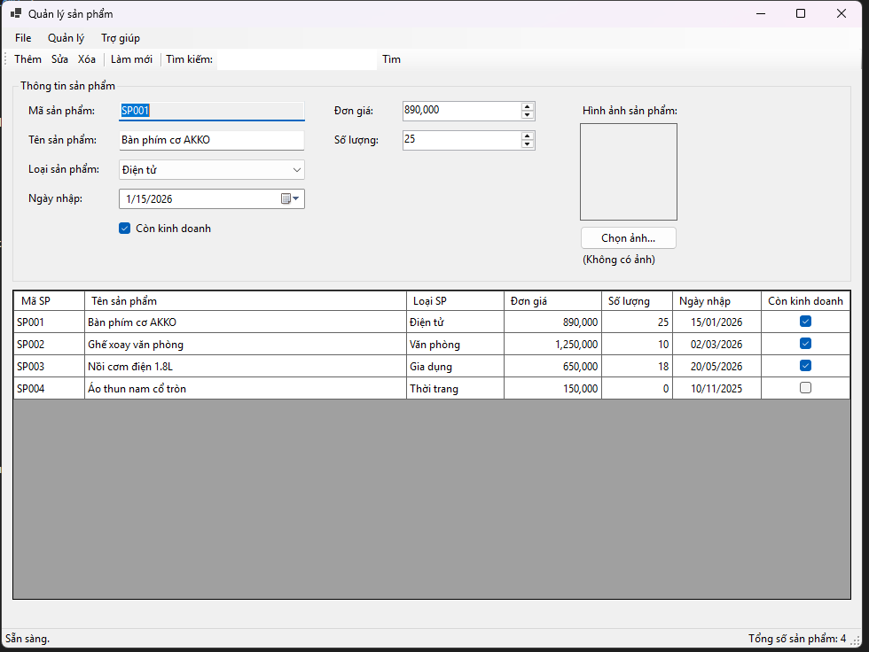
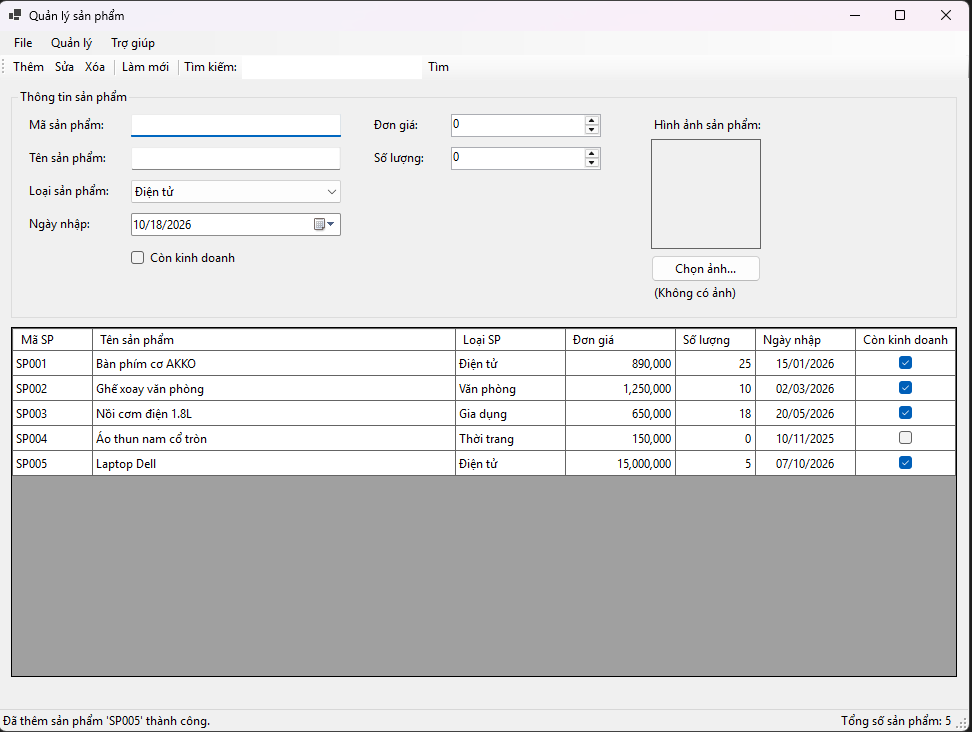
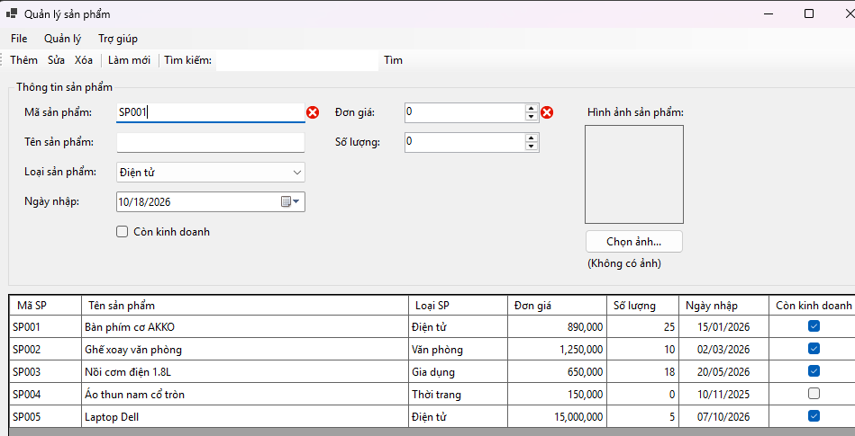
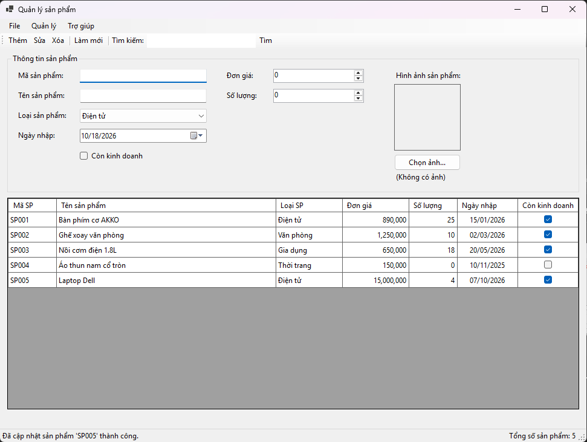
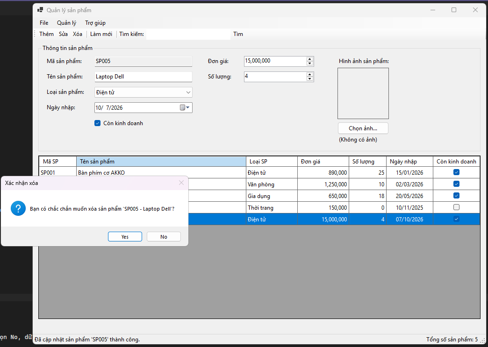
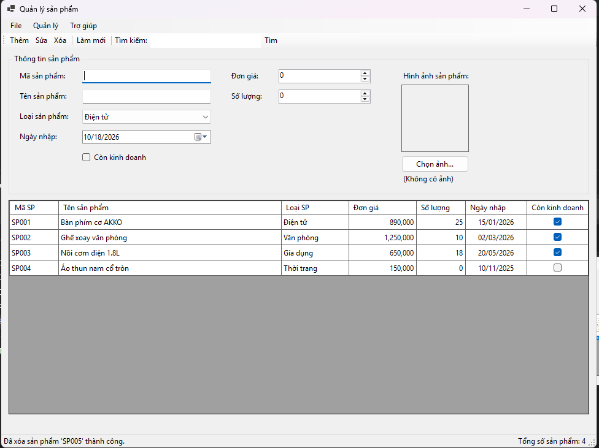
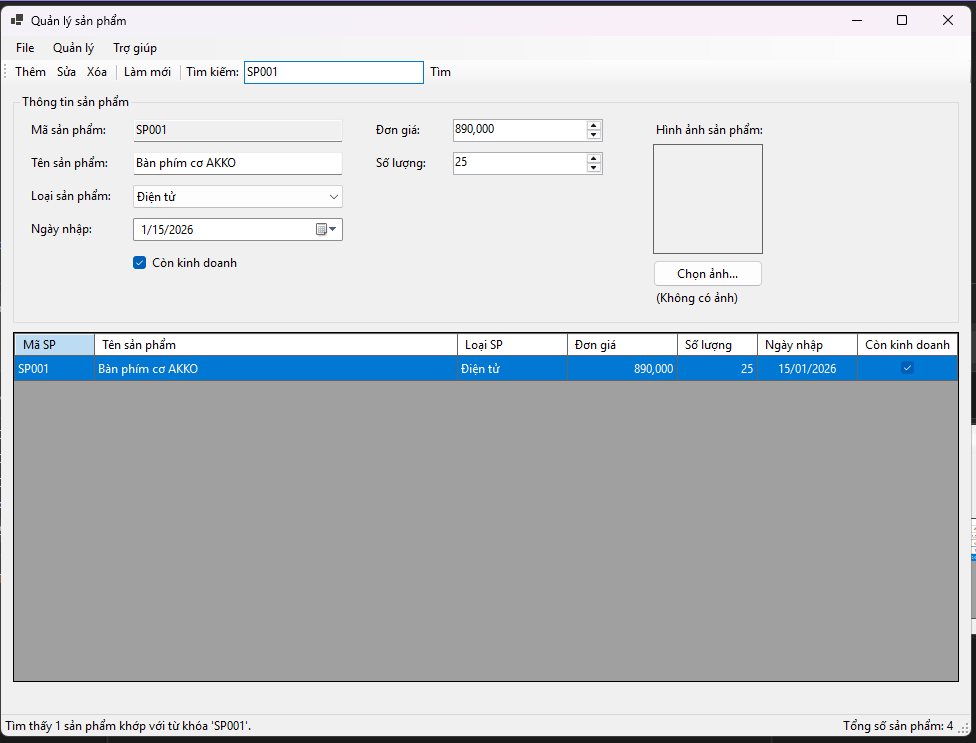
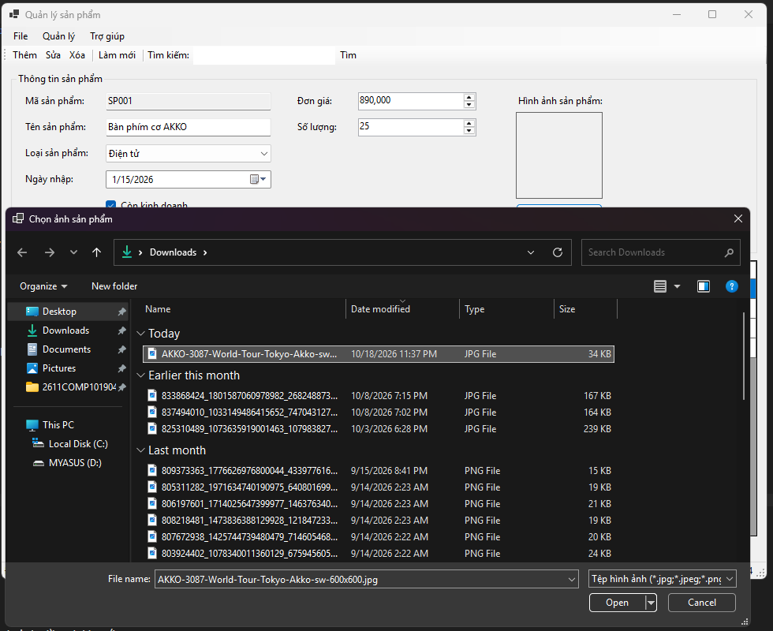
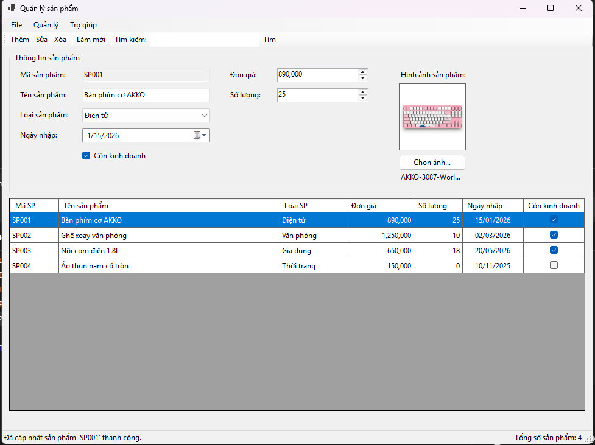
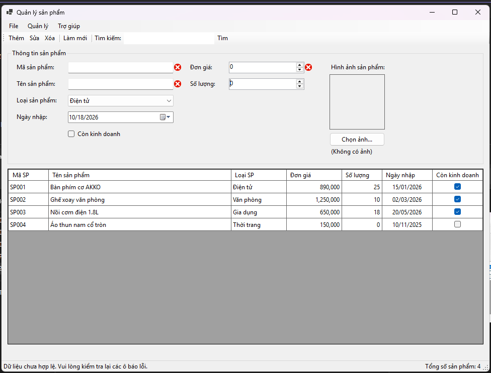

# COMP1019 - Lập trình trên Windows

## Lab 06 - Windows Forms nâng cao và DataGridView

## 1. Giới thiệu

Bài Lab 06 yêu cầu xây dựng ứng dụng Windows Forms bằng C# có tên **ProductManager**, dùng để quản lý danh sách sản phẩm của một cửa hàng.

Ứng dụng sử dụng `DataGridView` để hiển thị danh sách sản phẩm và cho phép người dùng thực hiện các thao tác thêm, sửa, xóa, tìm kiếm và làm mới dữ liệu. Ngoài ra, chương trình sử dụng các thành phần giao diện nâng cao như `MenuStrip`, `ToolStrip`, `StatusStrip`, `ContextMenuStrip`, `BindingSource` và `ErrorProvider`.

Dữ liệu sản phẩm được lưu trữ trong bộ nhớ bằng `List`, `BindingList` hoặc `BindingSource`, chưa yêu cầu kết nối với SQL Server hay cơ sở dữ liệu khác.

## 2. Mục tiêu bài Lab

- Thiết kế giao diện quản lý dữ liệu bằng Windows Forms.
- Hiển thị danh sách sản phẩm bằng `DataGridView`.
- Thực hiện các chức năng thêm, sửa, xóa, tìm kiếm và làm mới dữ liệu.
- Sử dụng `ErrorProvider` để kiểm tra và thông báo lỗi nhập liệu.
- Sử dụng `MenuStrip`, `ToolStrip`, `StatusStrip` và `ContextMenuStrip` để thao tác nhanh.
- Sử dụng `BindingSource` để quản lý nguồn dữ liệu hiển thị.
- Sử dụng `OpenFileDialog` và `PictureBox` để chọn và hiển thị ảnh sản phẩm.
- Tách các chức năng xử lý thành những phương thức riêng biệt, giúp mã nguồn dễ đọc và bảo trì.

## 3. Chức năng chương trình

| Chức năng | Mô tả |
|---|---|
| Hiển thị sản phẩm | Hiển thị danh sách sản phẩm trên `DataGridView` |
| Thêm sản phẩm | Kiểm tra dữ liệu và thêm sản phẩm mới |
| Sửa sản phẩm | Đưa thông tin sản phẩm lên Form và cập nhật dữ liệu |
| Xóa sản phẩm | Xác nhận trước khi xóa sản phẩm |
| Tìm kiếm | Tìm theo mã hoặc tên sản phẩm, không phân biệt chữ hoa/thường |
| Làm mới | Xóa nội dung nhập, bỏ thông báo lỗi và hiển thị lại toàn bộ danh sách |
| Chọn ảnh | Chọn file ảnh bằng `OpenFileDialog` và hiển thị trong `PictureBox` |
| Kiểm tra dữ liệu | Sử dụng `ErrorProvider` để thông báo dữ liệu không hợp lệ |
| Menu và thanh công cụ | Thực hiện nhanh các chức năng quản lý |
| Trạng thái chương trình | Hiển thị thông báo thao tác và số lượng sản phẩm hiện có |

## 4. Thiết kế giao diện

Form chính có tên `FrmProduct`, tiêu đề **Quản lý sản phẩm**. Giao diện được chia thành các khu vực: menu, thanh công cụ, thông tin sản phẩm, danh sách sản phẩm và thanh trạng thái.

### 4.1. MenuStrip

Menu chính gồm ba nhóm:

| Menu | Chức năng gợi ý |
|---|---|
| File | Làm mới, thoát chương trình |
| Quản lý | Thêm, sửa, xóa, tìm kiếm sản phẩm |
| Trợ giúp | Giới thiệu thông tin ứng dụng |

### 4.2. ToolStrip

Thanh công cụ cung cấp các nút thao tác nhanh:

| Nút | Chức năng |
|---|---|
| Thêm | Thêm sản phẩm mới |
| Sửa | Chỉnh sửa sản phẩm đang chọn |
| Xóa | Xóa sản phẩm đang chọn |
| Làm mới | Đặt lại biểu mẫu và hiển thị toàn bộ dữ liệu |
| Tìm kiếm | Tìm sản phẩm theo mã hoặc tên |

### 4.3. GroupBox Thông tin sản phẩm

| Control | Tên control | Chức năng |
|---|---|---|
| TextBox | `txtMaSP` | Nhập mã sản phẩm |
| TextBox | `txtTenSP` | Nhập tên sản phẩm |
| ComboBox | `cboLoaiSP` | Chọn loại sản phẩm |
| NumericUpDown | `numDonGia` | Nhập đơn giá |
| NumericUpDown | `numSoLuong` | Nhập số lượng |
| DateTimePicker | `dtpNgayNhap` | Chọn ngày nhập |
| CheckBox | `chkConKinhDoanh` | Xác định trạng thái kinh doanh |
| PictureBox | `picAnhSP` | Hiển thị ảnh sản phẩm |
| Button | `btnChonAnh` | Mở hộp thoại chọn ảnh |

Các loại sản phẩm gồm:

- Điện tử
- Văn phòng
- Gia dụng
- Thời trang

### 4.4. DataGridView

`dgvProducts` dùng để hiển thị danh sách sản phẩm với các cột thông tin phù hợp, chẳng hạn:

| Cột | Nội dung |
|---|---|
| Mã sản phẩm | Mã định danh sản phẩm |
| Tên sản phẩm | Tên sản phẩm |
| Loại sản phẩm | Nhóm sản phẩm |
| Đơn giá | Giá của một sản phẩm |
| Số lượng | Số lượng tồn |
| Ngày nhập | Ngày nhập sản phẩm |
| Trạng thái | Còn kinh doanh hoặc ngừng kinh doanh |

Các thuộc tính cần thiết:

- `ReadOnly = true`: không cho chỉnh sửa trực tiếp trên bảng.
- `SelectionMode = FullRowSelect`: chọn toàn bộ dòng.
- `MultiSelect = false`: chỉ cho chọn một dòng.
- `AllowUserToAddRows = false`: không hiển thị dòng thêm mới mặc định nếu việc thêm được thực hiện qua Form.

### 4.5. ContextMenuStrip

Khi nhấn chuột phải trên một dòng của `DataGridView`, menu ngữ cảnh cung cấp các chức năng:

- **Sửa:** đưa thông tin dòng đang chọn lên Form.
- **Xóa:** xác nhận và xóa sản phẩm.
- **Xem chi tiết:** hiển thị đầy đủ thông tin sản phẩm.

### 4.6. StatusStrip

Thanh trạng thái sử dụng các Label để hiển thị:

- Trạng thái thao tác gần nhất.
- Tổng số sản phẩm hiện có.

Ví dụ: `Đã thêm sản phẩm thành công | Số lượng sản phẩm: 4`.

## 5. Cấu trúc dữ liệu sản phẩm

Chương trình tạo class `Product` để lưu thông tin của từng sản phẩm.

| Thuộc tính | Kiểu dữ liệu | Quy định |
|---|---|---|
| `MaSP` | `string` | Không rỗng, không được trùng |
| `TenSP` | `string` | Không rỗng |
| `LoaiSP` | `string` | Thuộc danh sách loại sản phẩm |
| `DonGia` | `decimal` | Lớn hơn 0 |
| `SoLuong` | `int` | Lớn hơn hoặc bằng 0 |
| `NgayNhap` | `DateTime` | Không lớn hơn ngày hiện tại |
| `ConKinhDoanh` | `bool` | Xác định trạng thái kinh doanh |
| `DuongDanAnh` | `string` | Đường dẫn ảnh, có thể để trống |

Dữ liệu có thể được lưu trong `BindingList<Product>` và liên kết với `DataGridView` thông qua `BindingSource`. Khi danh sách thay đổi, giao diện được cập nhật phù hợp với cách tổ chức nguồn dữ liệu.

## 6. Các chức năng chi tiết

### 6.1. Khởi tạo Form

Khi Form được mở, chương trình:

- Khởi tạo danh sách loại sản phẩm.
- Tạo ít nhất 3 sản phẩm mẫu.
- Thiết lập `BindingSource` và liên kết dữ liệu với `dgvProducts`.
- Cấu hình các thuộc tính hiển thị của `DataGridView`.
- Thiết lập giá trị mặc định cho các trường nhập liệu.
- Cập nhật trạng thái và số lượng sản phẩm trên `StatusStrip`.

### 6.2. Thêm sản phẩm

Khi người dùng nhấn **Thêm**, chương trình:

1. Kiểm tra mã sản phẩm không được để trống.
2. Kiểm tra mã sản phẩm chưa tồn tại trong danh sách.
3. Kiểm tra tên sản phẩm không được để trống.
4. Kiểm tra loại sản phẩm hợp lệ.
5. Kiểm tra đơn giá lớn hơn 0.
6. Kiểm tra số lượng lớn hơn hoặc bằng 0.
7. Kiểm tra ngày nhập không vượt quá ngày hiện tại.
8. Thêm sản phẩm vào danh sách nếu dữ liệu hợp lệ.
9. Cập nhật bảng dữ liệu và thanh trạng thái.
10. Thông báo kết quả thao tác.

Nếu dữ liệu không hợp lệ, `ErrorProvider` hiển thị thông báo lỗi tại trường tương ứng.

### 6.3. Sửa sản phẩm

Khi người dùng chọn một dòng và nhấn **Sửa**, chương trình:

- Kiểm tra đã chọn sản phẩm.
- Đưa dữ liệu của sản phẩm lên các control nhập liệu.
- Cho phép người dùng thay đổi thông tin.
- Kiểm tra dữ liệu sau khi chỉnh sửa.
- Đảm bảo mã sản phẩm không trùng với sản phẩm khác.
- Cập nhật danh sách và `DataGridView`.
- Thông báo kết quả trên `StatusStrip`.

Nếu chưa chọn dòng nào, chương trình hiển thị thông báo phù hợp thay vì phát sinh lỗi.

### 6.4. Xóa sản phẩm

Khi người dùng nhấn **Xóa**, chương trình:

1. Kiểm tra đã chọn một dòng trong `DataGridView`.
2. Hiển thị `MessageBox` xác nhận xóa.
3. Nếu người dùng chọn Yes, xóa sản phẩm khỏi danh sách.
4. Nếu người dùng chọn No, giữ nguyên dữ liệu.
5. Cập nhật lại bảng và số lượng sản phẩm.

### 6.5. Tìm kiếm sản phẩm

Chương trình hỗ trợ tìm kiếm theo mã hoặc tên sản phẩm.

- Tìm kiếm theo mã sản phẩm.
- Tìm kiếm theo tên sản phẩm.
- Không phân biệt chữ hoa và chữ thường.
- Hiển thị những sản phẩm phù hợp với từ khóa.
- Thông báo nếu không tìm thấy sản phẩm.

Ví dụ: tìm từ khóa `laptop` vẫn có thể tìm được sản phẩm có tên `Laptop Dell`.

### 6.6. Làm mới dữ liệu

Khi nhấn **Làm mới**, chương trình:

- Xóa nội dung các ô nhập liệu.
- Đặt lại loại sản phẩm và các giá trị mặc định.
- Xóa ảnh đang xem trước nếu phù hợp với cách triển khai.
- Xóa thông báo lỗi trên `ErrorProvider`.
- Hiển thị lại toàn bộ danh sách sản phẩm.
- Cập nhật số lượng sản phẩm và trạng thái thao tác.

### 6.7. Chọn ảnh sản phẩm

Chương trình sử dụng `OpenFileDialog` để chọn ảnh từ máy tính.

Các bước xử lý:

1. Nhấn nút **Chọn ảnh**.
2. Mở hộp thoại chọn file ảnh.
3. Lọc các định dạng ảnh phù hợp như PNG, JPG, JPEG và BMP.
4. Nếu người dùng chọn file hợp lệ, hiển thị ảnh trên `PictureBox`.
5. Lưu đường dẫn ảnh vào thuộc tính `DuongDanAnh` của sản phẩm.

Nếu người dùng hủy hộp thoại, chương trình giữ nguyên dữ liệu hiện tại.

### 6.8. Cập nhật thanh trạng thái

Sau mỗi thao tác thêm, sửa, xóa, tìm kiếm hoặc làm mới, chương trình cập nhật:

- Thông báo kết quả thao tác.
- Tổng số sản phẩm hiện có hoặc đang hiển thị, tùy cách thiết kế.

Cần xác định rõ số lượng trên thanh trạng thái là tổng số sản phẩm trong danh sách hay số kết quả tìm kiếm để tránh gây nhầm lẫn.

## 7. Các phương thức và thành phần chính

| Thành phần | Nhiệm vụ |
|---|---|
| `Product` | Lưu trữ thông tin sản phẩm |
| `FrmProduct` | Xây dựng giao diện và điều phối các thao tác |
| `ValidateInput()` | Kiểm tra dữ liệu nhập |
| `ClearInput()` | Đặt lại các control |
| `LoadProductToForm()` | Đưa dữ liệu sản phẩm lên Form |
| `UpdateStatus()` | Cập nhật trạng thái và số lượng sản phẩm |
| `BindingSource` | Liên kết dữ liệu với `DataGridView` |
| `ErrorProvider` | Hiển thị lỗi nhập liệu |
| `OpenFileDialog` | Chọn file ảnh sản phẩm |

Các sự kiện thường sử dụng:

| Sự kiện | Mục đích |
|---|---|
| `FrmProduct_Load` | Khởi tạo dữ liệu mẫu và giao diện |
| `btnThem_Click` | Thêm sản phẩm |
| `btnSua_Click` | Sửa sản phẩm |
| `btnXoa_Click` | Xóa sản phẩm |
| `btnLamMoi_Click` | Làm mới biểu mẫu |
| `btnTimKiem_Click` | Tìm kiếm sản phẩm |
| `dgvProducts_CellClick` | Chọn sản phẩm và đưa dữ liệu lên Form nếu cần |
| Sự kiện chọn ảnh | Mở hộp thoại và hiển thị ảnh |
| Sự kiện ContextMenuStrip | Sửa, xóa hoặc xem chi tiết dòng được chọn |

## 8. Dữ liệu kiểm thử

### 8.1. Khởi tạo dữ liệu mẫu

**Dữ liệu kiểm thử:** Mở chương trình lần đầu.

**Kết quả mong đợi:**

- Danh sách loại sản phẩm được nạp.
- Có ít nhất 3 sản phẩm mẫu.
- `DataGridView` hiển thị đúng dữ liệu.
- `StatusStrip` hiển thị đúng số lượng sản phẩm ban đầu.



### 8.2. Thêm sản phẩm hợp lệ

**Dữ liệu kiểm thử:**

- Mã sản phẩm: SP004
- Tên sản phẩm: Laptop Dell
- Loại sản phẩm: Điện tử
- Đơn giá: 15000000
- Số lượng: 5
- Ngày nhập: Ngày hiện tại
- Trạng thái: Còn kinh doanh

**Kết quả mong đợi:** Sản phẩm được thêm vào danh sách và số lượng sản phẩm tăng lên 1.



### 8.3. Kiểm tra mã sản phẩm trùng

**Dữ liệu kiểm thử:** Nhập mã sản phẩm đã tồn tại và nhấn Thêm.

**Kết quả mong đợi:** Chương trình không thêm sản phẩm và thông báo lỗi mã trùng bằng `ErrorProvider` hoặc thông báo phù hợp.



### 8.4. Sửa sản phẩm

**Dữ liệu kiểm thử:** Chọn một sản phẩm, thay đổi tên hoặc số lượng rồi nhấn Sửa.

**Kết quả mong đợi:** Thông tin được cập nhật chính xác trên `DataGridView`.



### 8.5. Xóa sản phẩm

**Dữ liệu kiểm thử:** Chọn một sản phẩm và nhấn Xóa.

**Kết quả mong đợi:** Chương trình yêu cầu xác nhận. Nếu chọn Yes, sản phẩm bị xóa; nếu chọn No, dữ liệu không thay đổi.





### 8.6. Tìm kiếm sản phẩm

**Dữ liệu kiểm thử:** Nhập từ khóa là một phần tên sản phẩm hoặc mã sản phẩm.

**Kết quả mong đợi:** Bảng hiển thị các sản phẩm phù hợp; nếu không có kết quả, chương trình thông báo rõ ràng.



### 8.7. Chọn ảnh sản phẩm

**Dữ liệu kiểm thử:** Chọn một file ảnh PNG hoặc JPG.

**Kết quả mong đợi:** Ảnh được hiển thị trên `PictureBox` và đường dẫn được lưu vào sản phẩm.





### 8.8. Kiểm tra dữ liệu không hợp lệ

**Dữ liệu kiểm thử:**

- Để trống mã sản phẩm hoặc tên sản phẩm.
- Nhập đơn giá bằng 0.
- Nhập số lượng âm nếu control cho phép.
- Chọn ngày nhập lớn hơn ngày hiện tại.

**Kết quả mong đợi:** Chương trình không thêm hoặc cập nhật dữ liệu không hợp lệ; lỗi được hiển thị tại trường tương ứng.



## 9. Cấu trúc thư mục

```text
Lab06/
├── ProductManager/
│   ├── Models/
│   │   └── Product.cs
│   ├── FrmProduct.cs
│   ├── FrmProduct.Designer.cs
│   ├── FrmProduct.resx
│   ├── Program.cs
│   └── ProductManager.csproj
├── images/
│   ├── danhsachsanpham.png
│   ├── themsanpham.png
│   ├── matrung.png
│   ├── suasanpham.png
│   ├── xoasanpham.png
│   ├── timkiemsanpham.png
│   ├── chonanh.png
│   └── kiemtradulieu.png
└── README.md
```

*Lưu ý: Cấu trúc trên là gợi ý. Nếu project của bạn không có thư mục `Models`, có thể đặt `Product.cs` tại thư mục project chính. Không cần tạo các file ảnh giả chỉ để khớp cấu trúc.*

## 10. Kiến thức áp dụng

- Xây dựng giao diện Windows Forms bằng C#.
- Sử dụng `DataGridView` để hiển thị dữ liệu.
- Liên kết dữ liệu bằng `BindingSource` và `BindingList<T>` hoặc cách quản lý danh sách phù hợp.
- Thực hiện thêm, sửa, xóa, tìm kiếm và làm mới dữ liệu.
- Kiểm tra dữ liệu đầu vào bằng `ErrorProvider`.
- Sử dụng `MenuStrip`, `ToolStrip`, `StatusStrip` và `ContextMenuStrip`.
- Sử dụng `OpenFileDialog` và `PictureBox` để chọn, hiển thị ảnh.
- Tổ chức chương trình thành class và các phương thức riêng biệt.
- Xử lý các trường hợp chưa chọn dòng hoặc dữ liệu không hợp lệ để tránh lỗi chương trình.

## 11. Kết luận

Qua bài Lab 06, sinh viên thực hành xây dựng ứng dụng quản lý sản phẩm bằng Windows Forms với giao diện nâng cao và bảng dữ liệu `DataGridView`.

Bài tập giúp củng cố kỹ năng tổ chức dữ liệu bằng class, liên kết dữ liệu với giao diện, kiểm tra dữ liệu đầu vào, xử lý các thao tác CRUD cơ bản và sử dụng những thành phần giao diện hỗ trợ thao tác nhanh. Đây là nền tảng để phát triển ứng dụng quản lý dữ liệu có kết nối cơ sở dữ liệu ở các bài thực hành tiếp theo.