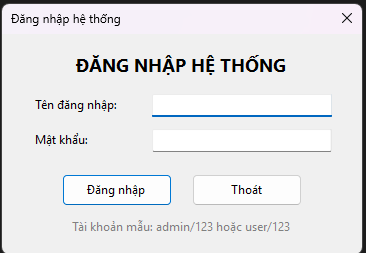
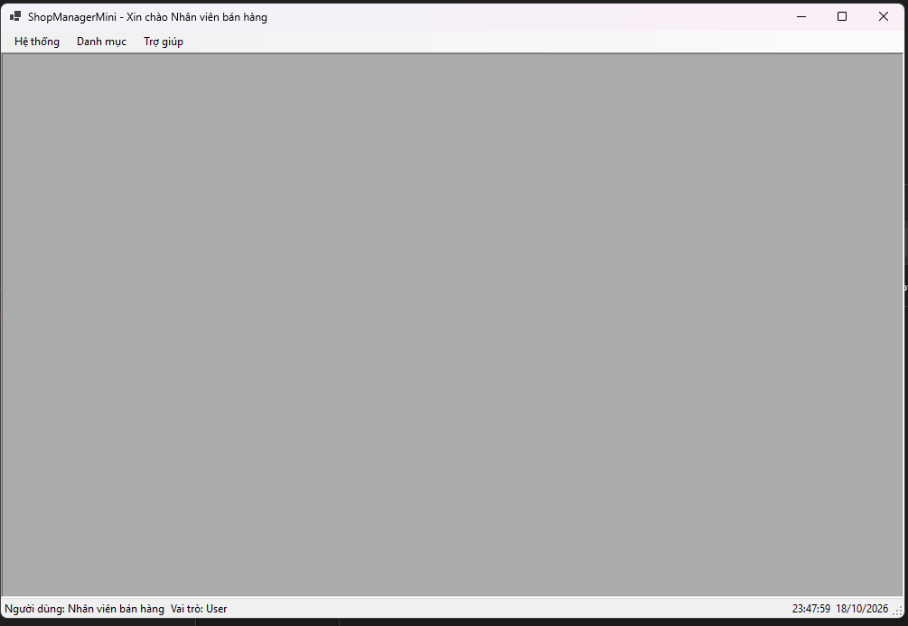
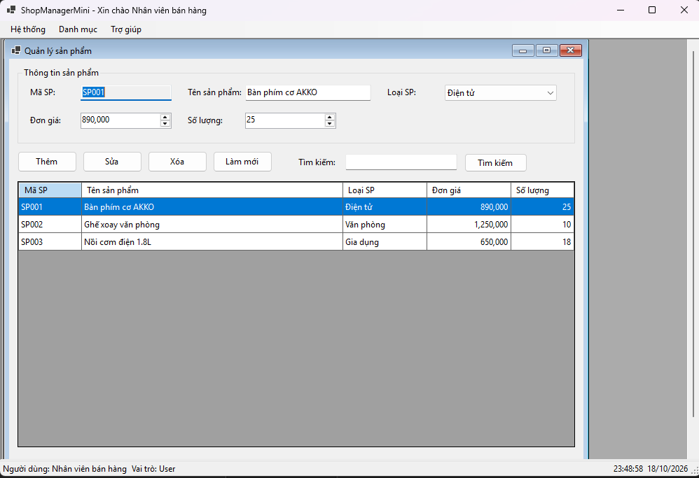
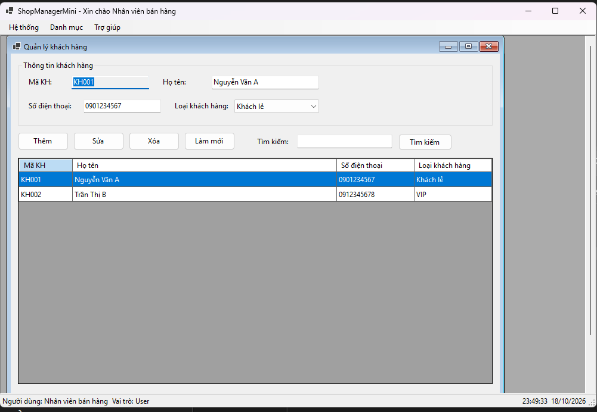

# COMP1019 - Lập trình trên Windows

## Lab 07 - SDI, MDI và ứng dụng nhiều Form trong C# WinForms

## 1. Giới thiệu

Bài Lab 07 xây dựng ứng dụng **ShopManagerMini** bằng C# WinForms nhằm thực hành thiết kế ứng dụng quản lý cửa hàng mini sử dụng nhiều Form.

Ứng dụng có chức năng đăng nhập, quản lý sản phẩm, quản lý khách hàng và giới thiệu thông tin phần mềm. Form chính được thiết kế theo mô hình MDI Parent, cho phép mở các Form chức năng bên trong cửa sổ chính.

Trong phạm vi bài lab, dữ liệu được lưu trữ tạm thời trong bộ nhớ bằng `List<T>` hoặc `BindingList<T>`, chưa yêu cầu kết nối cơ sở dữ liệu SQL Server.

## 2. Mục tiêu

- Xây dựng ứng dụng WinForms gồm nhiều Form có chức năng riêng biệt.
- Tạo Form đăng nhập và truyền thông tin người dùng sang Form chính.
- Sử dụng `ShowDialog()` để xử lý đăng nhập.
- Thiết kế Form chính dạng MDI Parent với `MenuStrip` và `StatusStrip`.
- Mở Form con MDI và tránh tạo nhiều Form cùng loại.
- Thực hiện thêm, sửa, xóa và tìm kiếm sản phẩm trong bộ nhớ.
- Sử dụng `DataGridView` để hiển thị dữ liệu.
- Thực hành kiểm tra dữ liệu đầu vào và sử dụng `MessageBox` để thông báo, xác nhận thao tác.

## 3. Công nghệ sử dụng

| Thành phần | Mô tả |
|---|---|
| Ngôn ngữ | C# |
| Nền tảng | .NET Windows Forms |
| Môi trường phát triển | Visual Studio |
| Giao diện | WinForms, MenuStrip, StatusStrip, DataGridView |
| Lưu trữ dữ liệu | `List<T>` hoặc `BindingList<T>` |
| Kiến trúc giao diện | Nhiều Form, MDI Parent và MDI Child |

## 4. Chức năng chương trình

| Form | Chức năng |
|---|---|
| `FrmLogin` | Nhập tài khoản, mật khẩu và kiểm tra đăng nhập. |
| `FrmMain` | Màn hình chính MDI, chứa menu chức năng và thông tin người dùng. |
| `FrmProduct` | Quản lý sản phẩm: thêm, sửa, xóa, tìm kiếm và hiển thị danh sách. |
| `FrmCustomer` | Quản lý khách hàng, thêm khách hàng và hiển thị danh sách. |
| `FrmAbout` | Hiển thị thông tin ứng dụng, sinh viên thực hiện và lớp học. |

### 4.1. Đăng nhập

Người dùng nhập tên đăng nhập và mật khẩu để truy cập ứng dụng.

Tài khoản mẫu:

| Username | Password | Họ tên | Vai trò |
|---|---|---|---|
| `admin` | `123` | Quản trị viên | Admin |
| `user` | `123` | Nhân viên bán hàng | User |

Các chức năng chính:

- Kiểm tra tài khoản và mật khẩu.
- Cảnh báo nếu bỏ trống thông tin đăng nhập.
- Hiển thị thông báo khi đăng nhập không thành công.
- Khi đăng nhập thành công, đóng Form đăng nhập và mở Form chính.
- Truyền họ tên và vai trò người dùng sang `FrmMain`.

### 4.2. Màn hình chính MDI

`FrmMain` là cửa sổ chính của ứng dụng, được thiết lập thuộc tính `IsMdiContainer = true`.

Menu chính gồm:

- **Hệ thống:** Đăng xuất, Thoát.
- **Danh mục:** Quản lý sản phẩm, Quản lý khách hàng.
- **Trợ giúp:** Giới thiệu.

`StatusStrip` hiển thị tên người dùng, vai trò hoặc thông tin trạng thái của ứng dụng.

Các Form chức năng được mở bên trong cửa sổ chính. Nếu Form cùng loại đã mở, chương trình kích hoạt Form hiện có thay vì tạo Form mới. Khi thoát ứng dụng, chương trình yêu cầu xác nhận trước khi đóng.

### 4.3. Quản lý sản phẩm

Thông tin sản phẩm gồm:

- Mã sản phẩm.
- Tên sản phẩm.
- Loại sản phẩm.
- Đơn giá.
- Số lượng.

Các chức năng:

- **Thêm:** Thêm sản phẩm mới vào danh sách.
- **Sửa:** Cập nhật thông tin sản phẩm được chọn.
- **Xóa:** Xóa sản phẩm sau khi người dùng xác nhận.
- **Làm mới:** Xóa nội dung nhập liệu trên Form.
- **Tìm kiếm:** Tìm sản phẩm theo thông tin phù hợp.
- **Hiển thị:** Dùng `DataGridView` để trình bày danh sách sản phẩm.

Các quy tắc kiểm tra dữ liệu:

- Không cho phép thêm sản phẩm trùng mã.
- Không chấp nhận đơn giá âm hoặc số lượng âm.
- Kiểm tra các trường bắt buộc trước khi thêm hoặc sửa.
- Hiển thị thông báo khi thao tác thành công hoặc thất bại.

### 4.4. Quản lý khách hàng

Thông tin khách hàng gồm mã khách hàng, họ tên, số điện thoại và loại khách hàng.

Các chức năng chính:

- Nhập thông tin khách hàng.
- Kiểm tra dữ liệu đầu vào.
- Thêm khách hàng vào danh sách lưu trong bộ nhớ.
- Hiển thị danh sách khách hàng bằng `DataGridView`.

Có thể mở rộng thêm chức năng sửa, xóa và tìm kiếm khách hàng.

### 4.5. Giới thiệu ứng dụng

`FrmAbout` hiển thị các thông tin:

- Tên ứng dụng: ShopManagerMini.
- Môn học: COMP1019 - Lập trình trên Windows.
- Họ tên sinh viên thực hiện.
- Lớp học.
- Phiên bản ứng dụng.

## 5. Thiết kế giao diện

Các Form được xây dựng bằng Windows Forms trong Visual Studio.

| Form | Thành phần giao diện chính |
|---|---|
| `FrmLogin` | TextBox username, TextBox password, nút Đăng nhập và nút Thoát. |
| `FrmMain` | MenuStrip, StatusStrip và vùng chứa Form con MDI. |
| `FrmProduct` | TextBox, ComboBox, DataGridView và các nút Thêm, Sửa, Xóa, Làm mới, Tìm kiếm. |
| `FrmCustomer` | Các ô nhập thông tin khách hàng, DataGridView và nút Thêm. |
| `FrmAbout` | Label hiển thị thông tin ứng dụng và sinh viên. |

### Ảnh chụp giao diện

**Màn hình đăng nhập**



**Màn hình chính MDI**



**Màn hình quản lý sản phẩm**



**Màn hình quản lý khách hàng**



## 6. Cấu trúc project

```text
Lab07/
├── ShopManagerMini/
│   ├── Models/
│   │   ├── User.cs
│   │   ├── Product.cs
│   │   └── Customer.cs
│   │
│   ├── Forms/
│   │   ├── FrmLogin.cs
│   │   ├── FrmMain.cs
│   │   ├── FrmProduct.cs
│   │   ├── FrmCustomer.cs
│   │   └── FrmAbout.cs
│   │
│   ├── Program.cs
│   └── ShopManagerMini.csproj
│
├── images/
│   ├── frm-login.png
│   ├── frm-main.png
│   ├── frm-product.png
│   └── frm-customer.png
│
└── README.md
```

*Lưu ý: Cấu trúc trên là cấu trúc đề xuất. Tên thư mục và file có thể khác tùy theo cách tổ chức project thực tế.*

## 7. Kiến thức áp dụng

- **SDI (Single Document Interface):** Mỗi cửa sổ hoạt động độc lập.
- **MDI (Multiple Document Interface):** Một cửa sổ chính có thể chứa nhiều cửa sổ con.
- **`ShowDialog()`:** Hiển thị Form theo dạng hộp thoại, phù hợp với Form đăng nhập.
- **`IsMdiContainer`:** Thiết lập một Form làm vùng chứa các Form con MDI.
- **`MdiParent`:** Xác định Form cha cho Form con.
- **Constructor và Property:** Truyền thông tin người dùng giữa các Form.
- **`List<T>` hoặc `BindingList<T>`:** Lưu trữ danh sách dữ liệu trong bộ nhớ.
- **`DataGridView`:** Hiển thị dữ liệu dạng bảng.
- **`MessageBox`:** Thông báo lỗi, thông báo kết quả và xác nhận thao tác.
- **Kiểm tra dữ liệu đầu vào:** Hạn chế dữ liệu không hợp lệ trước khi xử lý.

## 8. Kiểm thử chương trình

| STT | Tình huống kiểm thử | Kết quả mong đợi |
|---|---|---|
| 1 | Đăng nhập bằng `admin/123` | Đăng nhập thành công, mở Form chính. |
| 2 | Đăng nhập bằng `user/123` | Đăng nhập thành công với vai trò User. |
| 3 | Nhập sai tài khoản hoặc mật khẩu | Hiển thị thông báo lỗi. |
| 4 | Bỏ trống username hoặc password | Hiển thị cảnh báo nhập liệu. |
| 5 | Mở Quản lý sản phẩm nhiều lần | Chỉ có một Form sản phẩm được mở. |
| 6 | Thêm sản phẩm hợp lệ | Sản phẩm xuất hiện trong DataGridView. |
| 7 | Thêm sản phẩm trùng mã | Từ chối thêm và hiển thị thông báo. |
| 8 | Nhập đơn giá hoặc số lượng âm | Hiển thị cảnh báo dữ liệu không hợp lệ. |
| 9 | Xóa sản phẩm | Yêu cầu xác nhận trước khi xóa. |
| 10 | Thêm khách hàng hợp lệ | Khách hàng xuất hiện trong danh sách. |
| 11 | Chọn menu Giới thiệu | Hiển thị FrmAbout. |
| 12 | Chọn Thoát | Hiển thị hộp thoại xác nhận thoát. |

## 9. Kết luận

Qua bài Lab 07, sinh viên thực hành xây dựng ứng dụng WinForms nhiều Form, tổ chức giao diện theo mô hình MDI, truyền thông tin đăng nhập giữa các Form và quản lý dữ liệu trong bộ nhớ.

Bài lab giúp củng cố kiến thức về lập trình giao diện C#, xử lý sự kiện, kiểm tra dữ liệu đầu vào và tổ chức mã nguồn theo các lớp Model và Form riêng biệt.

## 10. Hướng dẫn chạy chương trình

1. Mở project `ShopManagerMini` bằng Visual Studio.
2. Chọn project `ShopManagerMini` làm Startup Project.
3. Build project để kiểm tra lỗi.
4. Chạy chương trình bằng `F5` hoặc `Ctrl + F5`.
5. Đăng nhập bằng một trong hai tài khoản mẫu.
6. Kiểm tra các chức năng quản lý sản phẩm, quản lý khách hàng và giới thiệu ứng dụng.

## 11. Câu hỏi nộp kèm

### Câu 1. SDI và MDI khác nhau như thế nào?

SDI là mô hình giao diện trong đó mỗi cửa sổ làm việc độc lập. MDI là mô hình có một cửa sổ cha chứa nhiều cửa sổ con bên trong. Trong bài lab, `FrmMain` sử dụng MDI để quản lý các Form sản phẩm và khách hàng.

### Câu 2. Vì sao Form đăng nhập nên dùng `ShowDialog()`?

`ShowDialog()` hiển thị Form theo dạng hộp thoại phương thức. Người dùng phải xử lý hoặc đóng hộp thoại trước khi tiếp tục thao tác với cửa sổ liên quan. Nhờ đó, chương trình có thể kiểm tra kết quả đăng nhập trước khi mở màn hình chính.

### Câu 3. Dữ liệu người dùng được truyền từ `FrmLogin` sang `FrmMain` bằng cách nào?

Sau khi đăng nhập thành công, Form đăng nhập có thể lưu thông tin người dùng vào đối tượng `User`, sau đó truyền đối tượng này vào constructor của `FrmMain` hoặc gán thông qua các property. `FrmMain` sử dụng thông tin nhận được để hiển thị họ tên và vai trò.

### Câu 4. Làm thế nào để không mở trùng Form sản phẩm?

Trước khi tạo `FrmProduct` mới, chương trình duyệt qua danh sách `MdiChildren` để kiểm tra xem đã có Form sản phẩm đang mở hay chưa. Nếu có, kích hoạt Form đó; nếu chưa, tạo và hiển thị Form mới.

### Câu 5. Khi nào nên dùng constructor, khi nào nên dùng property để truyền dữ liệu giữa các Form?

- **Constructor:** Phù hợp khi dữ liệu cần thiết phải được cung cấp ngay lúc tạo Form, chẳng hạn truyền đối tượng `User` vào `FrmMain`.
- **Property:** Phù hợp khi muốn đọc hoặc cập nhật dữ liệu sau khi Form đã được tạo, với điều kiện thiết kế property cho phép thao tác đó.

## Trả lời câu hỏi nộp kèm bản dài

**1. SDI và MDI khác nhau như thế nào?**

SDI (Single Document Interface) là mô hình mỗi Form là một cửa sổ độc
lập, ngang hàng nhau trên màn hình (ví dụ Notepad: mỗi file mở là 1 cửa
sổ riêng biệt, không nằm trong cửa sổ nào khác). MDI (Multiple Document
Interface) là mô hình có 1 Form "cha" (`IsMdiContainer = true`) đóng vai
trò khung chứa, và nhiều Form "con" (`MdiParent = formCha`) chỉ được hiển
thị bên trong vùng làm việc của Form cha đó (ví dụ Excel/Word bản cũ: mở
nhiều file nhưng tất cả đều nằm trong 1 cửa sổ ứng dụng lớn). Trong bài
lab này, `FrmMain` là MDI Parent, còn `FrmProduct`/`FrmCustomer` là MDI
Child.

**2. Vì sao Form đăng nhập nên dùng `ShowDialog()`?**

`ShowDialog()` mở Form ở chế độ **modal**: dòng lệnh gọi nó sẽ dừng lại
(block) cho đến khi Form đăng nhập đóng, và người dùng không thể tương
tác với bất kỳ cửa sổ nào khác của ứng dụng trong lúc đó. Điều này đảm
bảo luồng chạy đúng thứ tự bắt buộc: phải đăng nhập xong (đóng FrmLogin)
thì chương trình mới đi tiếp đến dòng mở `FrmMain`. Nếu dùng `Show()`
(non-modal) thì `Main()` sẽ chạy tiếp ngay lập tức mà không chờ kết quả
đăng nhập, dẫn đến `FrmMain` có thể được mở trước khi biết đăng nhập có
thành công hay không.

**3. Dữ liệu `User` được truyền từ FrmLogin sang FrmMain bằng cách nào?**

Qua 2 bước: (1) FrmLogin lưu đối tượng `User` đăng nhập thành công vào
property `public User NguoiDungDangNhap { get; private set; }` của chính
nó; (2) sau khi `frmLogin.ShowDialog()` trả về `DialogResult.OK`, code
trong `Program.cs` đọc `frmLogin.NguoiDungDangNhap` rồi truyền giá trị đó vào
**constructor** của `FrmMain`: `new FrmMain(nguoiDung)`.
FrmMain lưu lại vào field `nguoiDungHienTai` để dùng xuyên suốt vòng đời
của Form.

**4. Nếu bấm menu sản phẩm nhiều lần, chương trình xử lý sao để không mở
trùng Form?**

`FrmMain` giữ 1 biến field tham chiếu tới Form con đang mở, ví dụ
`private FrmProduct frmProductDangMo;`. Khi bấm menu "Quản lý sản phẩm":
nếu biến này đang `null` hoặc Form đã bị đóng (`frmProductDangMo.IsDisposed
== true`) thì mới tạo đối tượng `FrmProduct` mới, gán `MdiParent = this`
rồi `Show()`; đồng thời đăng ký sự kiện `FormClosed` để khi Form đó bị
đóng, biến lại được gán về `null`. Nếu biến đang tham chiếu tới 1 Form còn
sống (đã mở từ trước, user chỉ đang bấm menu lại) thì chương trình **không
tạo Form mới** mà chỉ gọi `Activate()` (và phục hồi `WindowState` nếu đang
bị thu nhỏ) để đưa Form đó lên trên, hiện rõ cho người dùng thấy.

**5. Khi nào nên dùng constructor, khi nào nên dùng property để truyền dữ
liệu giữa các Form?**

- Dùng **constructor** khi dữ liệu là bắt buộc phải có ngay từ lúc Form
  được tạo ra, Form không thể hoạt động đúng nếu thiếu nó (ví dụ `FrmMain`
  bắt buộc phải biết `User` nào đang đăng nhập ngay khi khởi tạo, vì Load
  sẽ dùng dữ liệu đó để hiển thị lên StatusStrip). Cách này buộc người gọi
  Form luôn phải cung cấp dữ liệu, tránh quên gán, giúp lỗi được phát hiện
  ngay lúc biên dịch/khởi tạo thay vì lúc chạy.
- Dùng **property** khi dữ liệu là tùy chọn, có thể gán sau khi Form đã
  được tạo, hoặc khi cần lấy kết quả RA từ Form sau khi nó đóng (ví dụ
  `FrmLogin.NguoiDungDangNhap` - Form đóng rồi code gọi nó mới đọc property
  này để lấy kết quả). Property cũng phù hợp khi dữ liệu có thể thay đổi
  nhiều lần trong vòng đời của Form, hoặc khi Form cần hoạt động được cả
  khi chưa có dữ liệu đó (ví dụ Form vẫn mở lên bình thường, dữ liệu sẽ
  được gán/cập nhật sau bởi 1 hành động khác).

Tóm lại: constructor = "dữ liệu đầu vào bắt buộc, có ngay từ đầu";
property = "dữ liệu tùy chọn / dữ liệu lấy ra sau / dữ liệu có thể thay
đổi theo thời gian".