# COMP1019 - Lập trình trên Windows

## Lab 08 - Xây dựng ứng dụng Paint đơn giản bằng WinForms và GDI+

## 1. Giới thiệu

Chương trình xây dựng một ứng dụng **Paint đơn giản bằng C# WinForms và GDI+**, cho phép người dùng vẽ trực tiếp trên vùng canvas bằng chuột.

Người dùng có thể chọn chế độ vẽ, chọn màu sắc, điều chỉnh độ dày nét vẽ, xóa nét vẽ gần nhất bằng Undo hoặc xóa toàn bộ vùng vẽ bằng Clear.

Các hình đã vẽ được lưu vào danh sách đối tượng để có thể vẽ lại khi cửa sổ thay đổi kích thước, bị che khuất hoặc được làm mới.

Chương trình được thực hiện bằng ngôn ngữ **C#**, sử dụng **Windows Forms App** trong Visual Studio.

---

## 2. Chức năng chương trình

Chương trình gồm các chức năng:

| STT | Chức năng                    | Mô tả |
| --- | -----------------------------| ------------------------------------------------------------------------|
| 1   | Vẽ tự do (Pen)               | Vẽ các nét tự do bằng cách di chuyển chuột trên canvas                  |
| 2   | Vẽ đường thẳng (Line)        | Vẽ đường thẳng từ điểm bắt đầu đến điểm kết thúc                        |
| 3   | Vẽ hình chữ nhật (Rectangle) | Vẽ hình chữ nhật bằng cách kéo chuột                                    |
| 4   | Vẽ hình ellipse (Ellipse)    | Vẽ hình ellipse bằng cách kéo chuột                                     |
| 5   | Chọn màu vẽ                  | Sử dụng ColorDialog để chọn màu                                         |
| 6   | Chọn độ dày nét vẽ           | Sử dụng NumericUpDown để điều chỉnh độ dày từ 1 đến 20                  |
| 7   | Undo                         | Xóa đối tượng được vẽ gần nhất                                          |
| 8   | Clear                        | Xóa toàn bộ đối tượng trên canvas                                       |
| 9   | Hiển thị tọa độ chuột        | Cập nhật tọa độ chuột trên Label trạng thái                             |
| 10  | Vẽ lại canvas                | Giữ nguyên các hình đã vẽ khi Form thay đổi kích thước hoặc được refresh|

---

## 3. Yêu cầu kỹ thuật

* Sử dụng **C# Windows Forms App**.
* Sử dụng thư viện đồ họa **GDI+** thông qua `System.Drawing`.
* Sử dụng `Graphics`, `Pen` và `Brush` để vẽ hình.
* Sử dụng sự kiện `Paint` của vùng canvas để vẽ lại các đối tượng.
* Xử lý các sự kiện `MouseDown`, `MouseMove` và `MouseUp` để vẽ bằng chuột.
* Sử dụng `List<DrawItem>` để lưu danh sách các đối tượng đã vẽ.
* Gọi `canvas.Invalidate()` khi dữ liệu vẽ thay đổi để yêu cầu vẽ lại canvas.
* Hỗ trợ các chế độ Pen, Line, Rectangle và Ellipse.
* Cho phép chọn màu bằng `ColorDialog`.
* Cho phép chọn độ dày nét vẽ từ 1 đến 20 bằng `NumericUpDown`.
* Hỗ trợ Undo và Clear.
* Hiển thị tọa độ chuột hiện tại trên Label trạng thái.
* Xử lý được trường hợp kéo chuột theo mọi hướng khi vẽ hình chữ nhật và ellipse.
* Giải phóng các đối tượng đồ họa được tạo ra như `Pen`, `Brush` bằng `using` hoặc `Dispose()`.
* Không chỉ vẽ trực tiếp trong `MouseMove` mà không lưu dữ liệu gốc.
* Các nét vẽ không bị mất khi Form thay đổi kích thước hoặc canvas được làm mới.

---

## 4. Các thành phần và phương thức chính

Chương trình có thể được tổ chức thành các thành phần sau:

```text
COMP1019_Lab08_SimplePaint
│
├── Form1.cs
├── Form1.Designer.cs
├── DrawItem.cs
└── Program.cs
```

### `DrawItem.cs`

Class `DrawItem` dùng để lưu thông tin của một đối tượng cần vẽ.

Các thông tin cần lưu gồm:

* Chế độ vẽ: Pen, Line, Rectangle hoặc Ellipse.
* Màu sắc của nét vẽ.
* Độ dày nét vẽ.
* Danh sách điểm đối với chế độ Pen.
* Điểm bắt đầu và điểm kết thúc đối với Line, Rectangle và Ellipse.

Các dữ liệu này được sử dụng để vẽ lại đối tượng trong sự kiện `Paint`.

### `Form1.cs`

Class `Form1` quản lý giao diện và các thao tác tương tác với người dùng.

Các phương thức và sự kiện chính có thể bao gồm:

```text
Form1_Load()
canvas_Paint()
canvas_MouseDown()
canvas_MouseMove()
canvas_MouseUp()
btnColor_Click()
btnUndo_Click()
btnClear_Click()
```

### `canvas_Paint()`

Vẽ lại toàn bộ các đối tượng đã được lưu trong danh sách `List<DrawItem>`.

Phương thức này duyệt qua danh sách và sử dụng `Graphics` để vẽ từng đối tượng theo chế độ, màu sắc và độ dày đã lưu.

Đây là phần quan trọng giúp các nét vẽ không bị mất khi canvas được refresh hoặc Form thay đổi kích thước.

### `canvas_MouseDown()`

Ghi nhận tọa độ bắt đầu khi người dùng nhấn chuột trên canvas.

Đối với chế độ Pen, phương thức khởi tạo danh sách điểm của nét vẽ mới.

Đối với các chế độ Line, Rectangle và Ellipse, phương thức lưu điểm bắt đầu của hình.

### `canvas_MouseMove()`

Cập nhật tọa độ chuột hiện tại và hiển thị trên Label trạng thái.

Nếu người dùng đang giữ chuột:

* Với Pen, thêm điểm mới vào nét vẽ.
* Với Line, Rectangle hoặc Ellipse, cập nhật điểm kết thúc để thể hiện hình đang vẽ.

Chương trình gọi `canvas.Invalidate()` khi cần cập nhật hình ảnh hiển thị.

### `canvas_MouseUp()`

Ghi nhận điểm kết thúc khi người dùng thả chuột.

Đối tượng vẽ hoàn chỉnh được lưu vào danh sách để có thể vẽ lại, Undo hoặc Clear.

### `btnColor_Click()`

Mở `ColorDialog` để người dùng chọn màu vẽ.

Màu đã chọn được áp dụng cho các nét vẽ tiếp theo.

### `btnUndo_Click()`

Xóa đối tượng cuối cùng trong danh sách nếu danh sách không rỗng.

Sau đó gọi `canvas.Invalidate()` để cập nhật vùng vẽ.

### `btnClear_Click()`

Xóa toàn bộ các đối tượng đã lưu trong danh sách và làm mới canvas.

### `Program.cs`

Chứa phương thức `Main()` để khởi chạy ứng dụng Windows Forms.

---

## 5. Giao diện chương trình

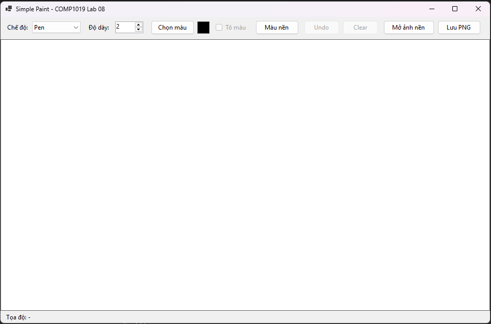

---

## 6. Dữ liệu kiểm thử

### Test 1: Vẽ tự do bằng Pen

Chọn chế độ Pen, sau đó nhấn giữ chuột và di chuyển trên canvas.

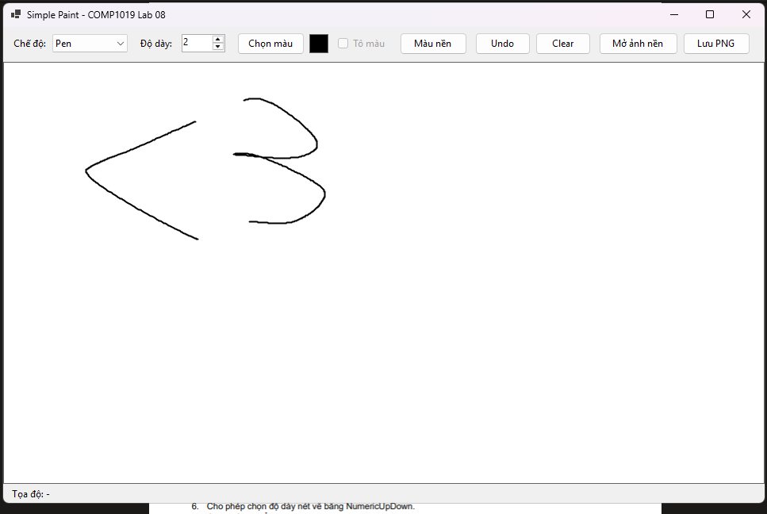

Kết quả mong đợi: chương trình tạo ra nét vẽ theo đường di chuyển của chuột.

### Test 2: Vẽ đường thẳng

Chọn chế độ Line, nhấn chuột tại điểm bắt đầu và kéo đến điểm kết thúc.

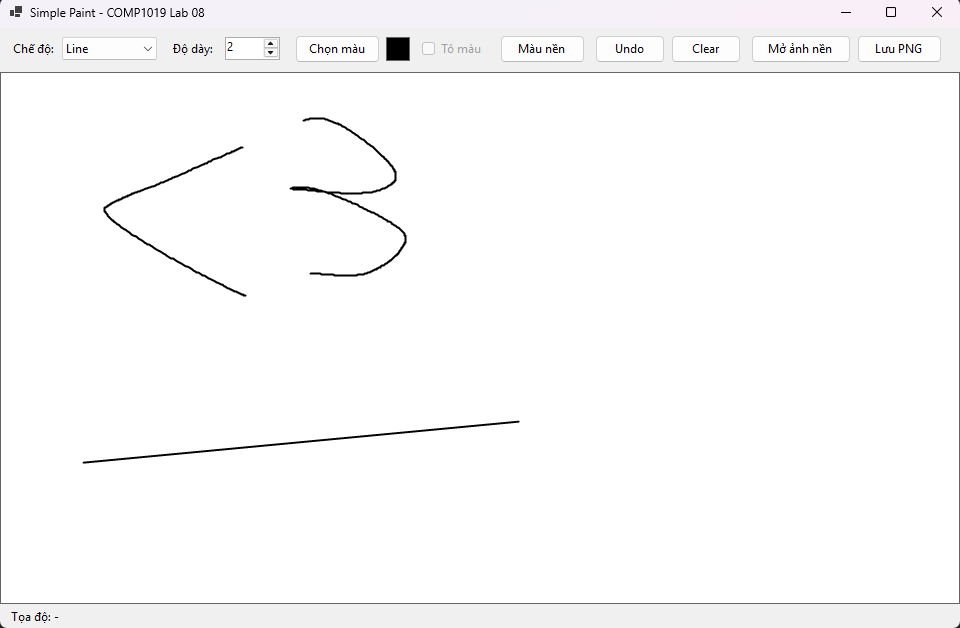

Kết quả mong đợi: chương trình vẽ được đường thẳng giữa hai điểm.

### Test 3: Vẽ hình chữ nhật

Chọn chế độ Rectangle và kéo chuột để xác định hai góc của hình chữ nhật.

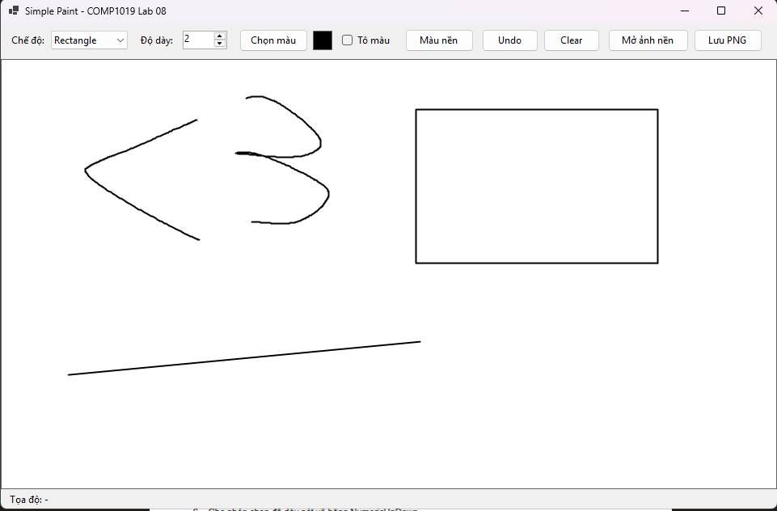

Kết quả mong đợi: hình chữ nhật được vẽ đúng theo vùng kéo chuột.

### Test 4: Vẽ hình ellipse

Chọn chế độ Ellipse và kéo chuột để xác định vùng chứa hình ellipse.

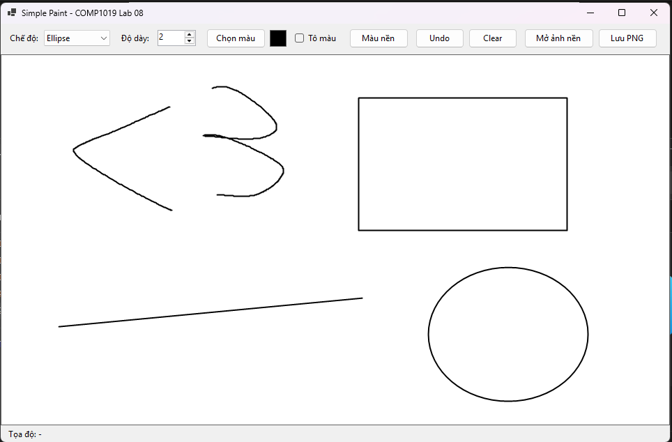

Kết quả mong đợi: chương trình vẽ được hình ellipse theo vùng kéo chuột.

### Test 5: Chọn màu vẽ

Nhấn nút chọn màu để mở ColorDialog và chọn màu mong muốn.

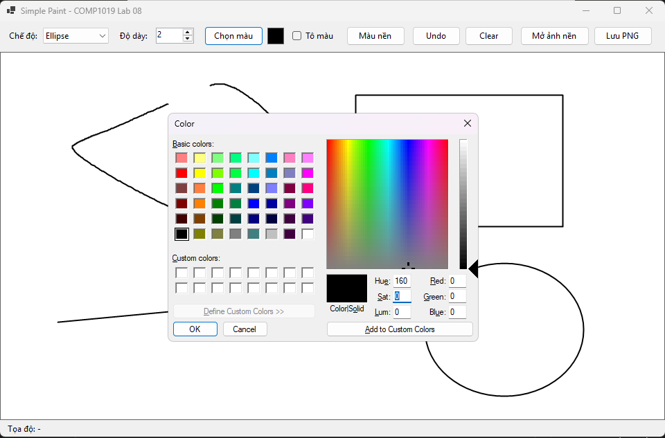

Kết quả mong đợi: các nét vẽ tiếp theo sử dụng màu đã chọn.

### Test 6: Thay đổi độ dày nét vẽ

Điều chỉnh NumericUpDown để chọn độ dày nét vẽ từ 1 đến 20.

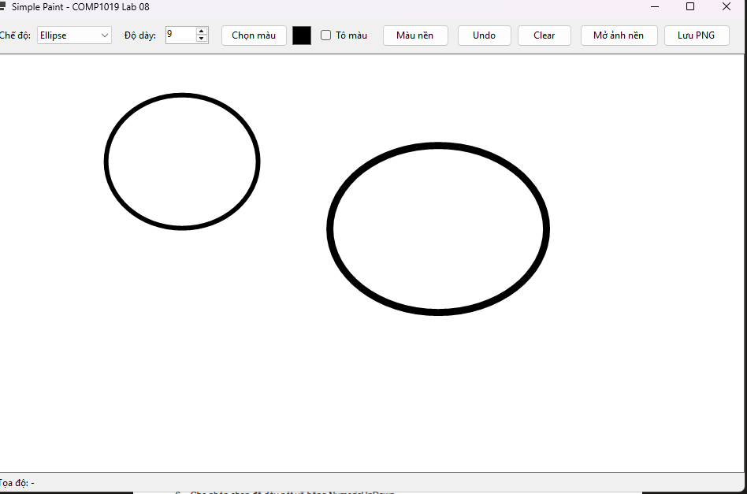

Kết quả mong đợi: nét vẽ tiếp theo có độ dày tương ứng với giá trị được chọn.

### Test 7: Undo

Vẽ nhiều nét hoặc hình khác nhau, sau đó nhấn nút Undo.

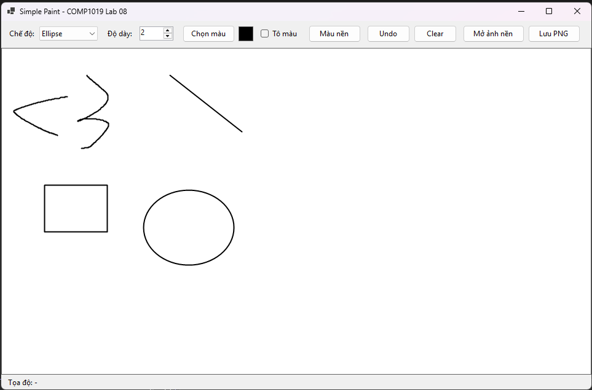

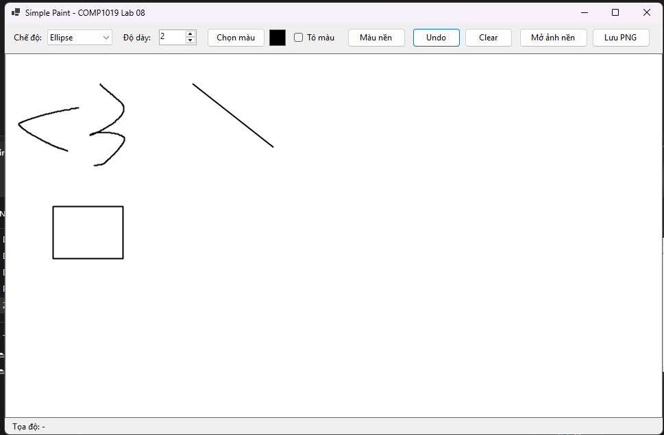

Kết quả mong đợi: đối tượng được vẽ gần nhất bị xóa, các đối tượng còn lại vẫn được giữ nguyên.

### Test 8: Clear

Vẽ một số hình trên canvas, sau đó nhấn nút Clear.

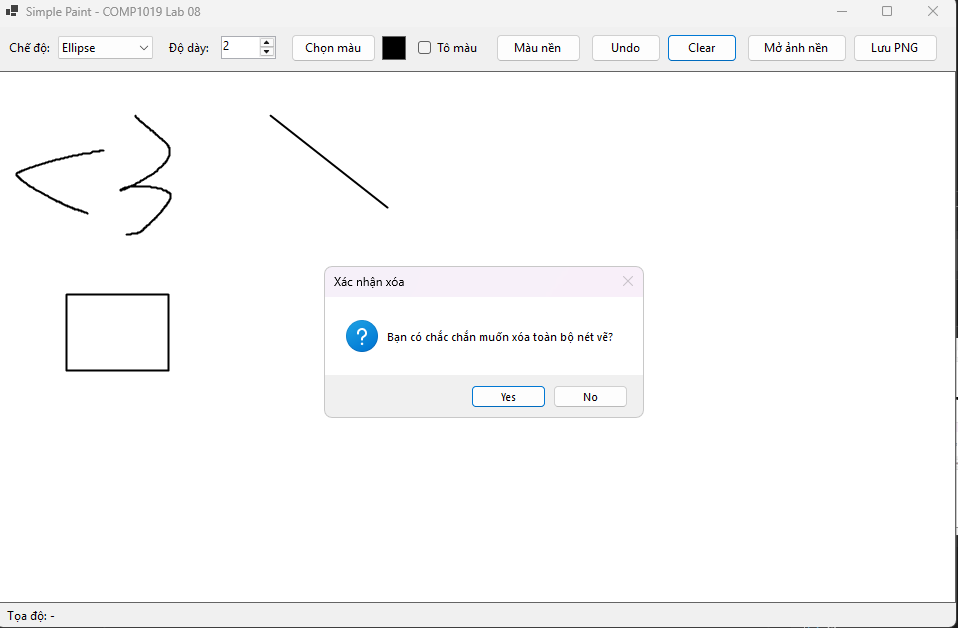

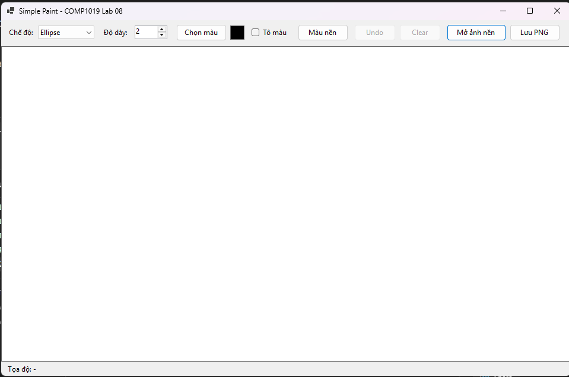

Kết quả mong đợi: toàn bộ đối tượng đã vẽ được xóa khỏi canvas.

### Test 9: Hiển thị tọa độ chuột

Di chuyển chuột trên vùng canvas.

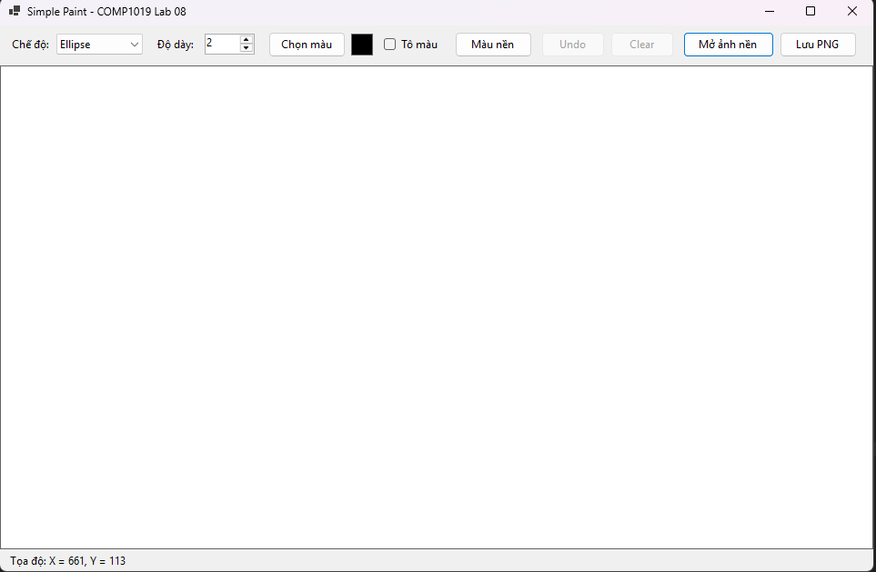

Kết quả mong đợi: Label trạng thái hiển thị tọa độ chuột hiện tại.

### Test 10: Kiểm tra khi thay đổi kích thước Form

Vẽ nhiều hình trên canvas, sau đó thay đổi kích thước cửa sổ hoặc chuyển sang cửa sổ khác rồi quay lại.

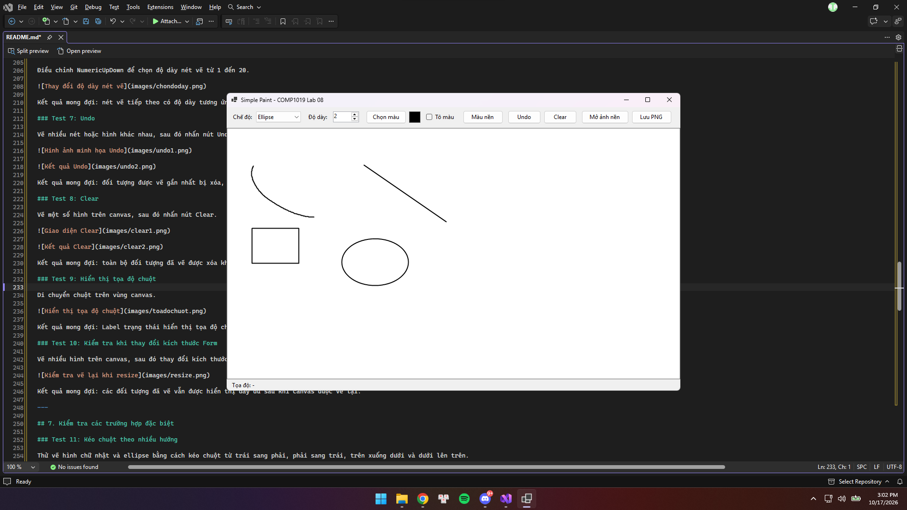

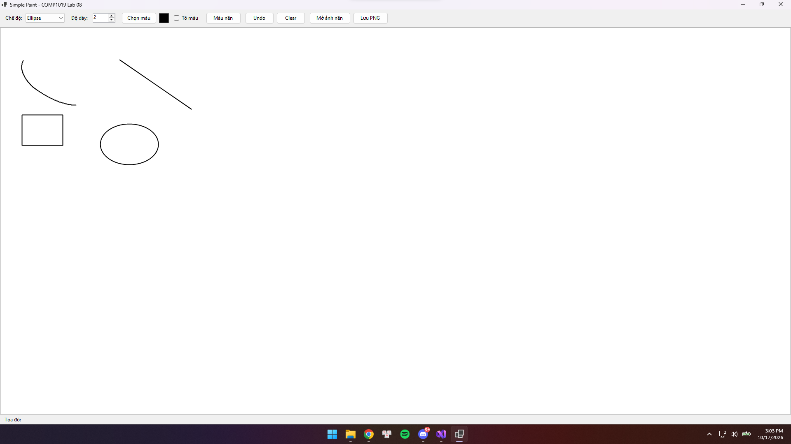

Kết quả mong đợi: các đối tượng đã vẽ vẫn được hiển thị đầy đủ sau khi canvas được vẽ lại.

---

## 7. Cơ chế lưu và vẽ lại đối tượng

Chương trình sử dụng `List<DrawItem>` để lưu các đối tượng đã vẽ.

Khi người dùng hoàn thành một nét vẽ hoặc hình vẽ, dữ liệu tương ứng được lưu vào danh sách.

Khi canvas cần được vẽ lại, sự kiện `Paint` duyệt qua danh sách và vẽ lại toàn bộ đối tượng.

Quy trình hoạt động:

```text
Người dùng thao tác chuột
          |
          v
Ghi nhận tọa độ và thông tin nét vẽ
          |
          v
Lưu đối tượng vào List<DrawItem>
          |
          v
Gọi canvas.Invalidate()
          |
          v
Sự kiện Paint được thực hiện
          |
          v
Vẽ lại toàn bộ đối tượng trên canvas
```

Cơ chế này giúp hình vẽ được giữ lại khi Form bị che khuất, thay đổi kích thước hoặc cần làm mới giao diện.

---

## 8. Chức năng nâng cao

Ngoài các chức năng bắt buộc, chương trình có thể được mở rộng thêm:

* Lưu vùng vẽ thành file PNG.
* Mở ảnh nền để vẽ đè lên ảnh.
* Sử dụng tổ hợp phím `Ctrl + Z` để Undo.
* Thêm chế độ tô màu hình chữ nhật hoặc ellipse.
* Thêm chức năng đổi màu nền canvas.

Các chức năng nâng cao được thực hiện tùy theo mức độ hoàn thiện của chương trình.

---

## 9. Kiến thức đã áp dụng

Qua bài Lab 08, chương trình vận dụng các kiến thức:

* C# Windows Forms.
* GDI+.
* `Graphics`.
* `Pen` và `Brush`.
* Sự kiện `Paint`.
* Các sự kiện `MouseDown`, `MouseMove`, `MouseUp`.
* `List<T>` để lưu đối tượng vẽ.
* `ColorDialog`.
* `NumericUpDown`.
* `Invalidate()`.
* Quản lý và giải phóng tài nguyên đồ họa.
* Tổ chức chương trình thành các class và phương thức riêng biệt.

---

## 10. Kết luận

Bài Lab 08 xây dựng ứng dụng Paint đơn giản bằng **C# WinForms và GDI+**, cho phép người dùng vẽ tự do, vẽ đường thẳng, hình chữ nhật và ellipse bằng chuột.

Chương trình hỗ trợ chọn màu, điều chỉnh độ dày nét vẽ, Undo, Clear và hiển thị tọa độ chuột. Việc lưu các đối tượng vẽ vào danh sách và vẽ lại trong sự kiện `Paint` giúp hình vẽ không bị mất khi giao diện được làm mới hoặc thay đổi kích thước.

Qua bài thực hành, sinh viên hiểu rõ hơn cách sử dụng các công cụ đồ họa trong WinForms và cách xử lý sự kiện chuột để xây dựng một ứng dụng vẽ tương tác.