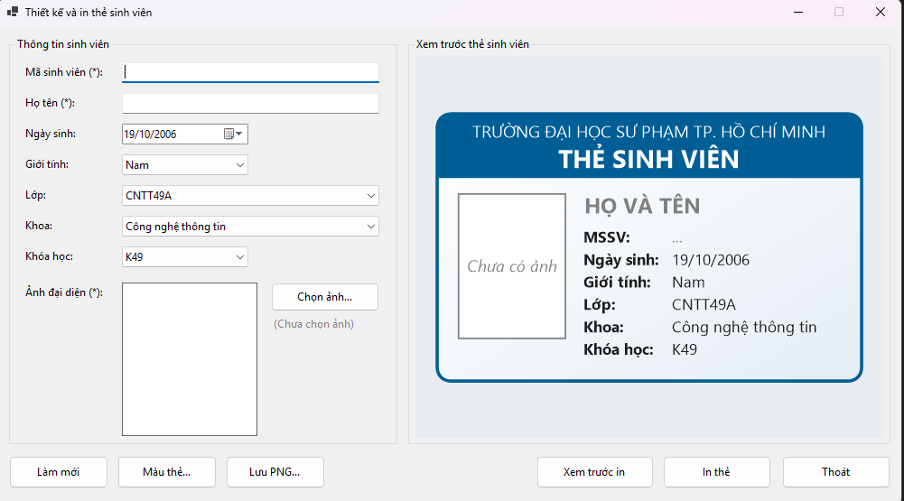
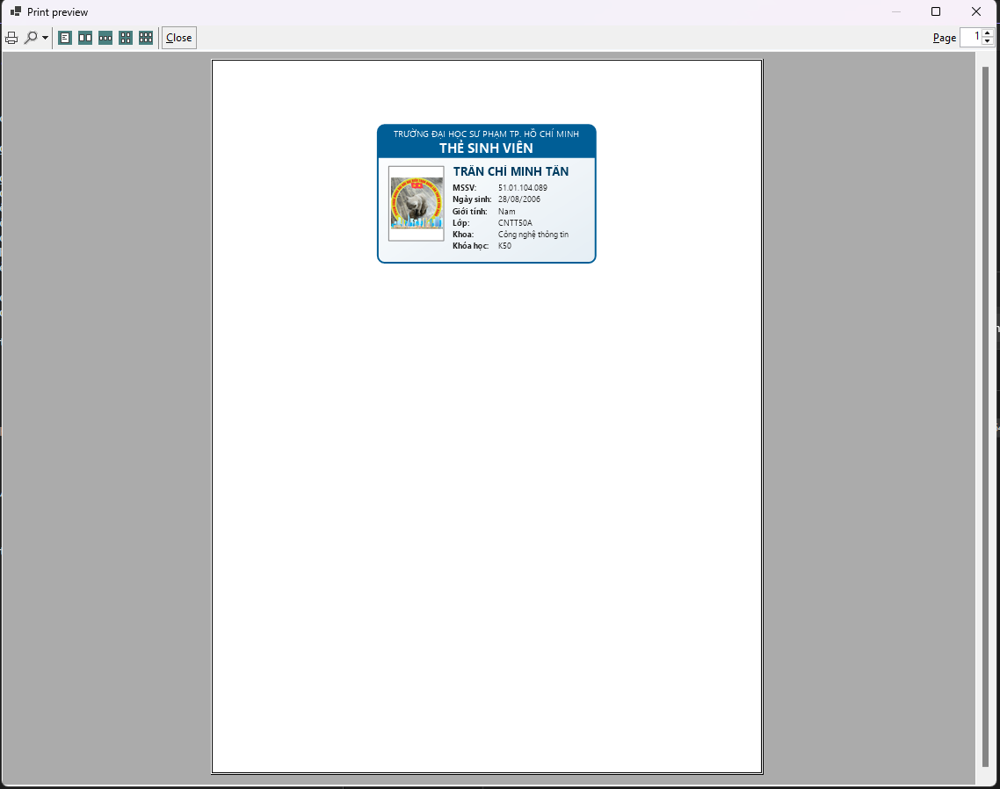

# COMP1019 - Lập trình trên Windows

## Lab 09 - Thiết kế và in thẻ sinh viên bằng WinForms

## 1. Giới thiệu

Bài Lab 09 yêu cầu xây dựng ứng dụng Windows Forms bằng C# có tên **FrmStudentCard**, cho phép nhập thông tin sinh viên, chọn ảnh đại diện, xem trước thẻ sinh viên và thực hiện in thẻ.

Ứng dụng sử dụng `PictureBox` để hiển thị ảnh đại diện, `Panel` và GDI+ để vẽ bản xem trước thẻ, đồng thời sử dụng `PrintDocument`, `PrintPreviewDialog` và `PrintDialog` để hỗ trợ xem trước và in thẻ sinh viên.

Dữ liệu được nhập trực tiếp trên Form và xử lý trong bộ nhớ. Bài tập chưa yêu cầu kết nối cơ sở dữ liệu.

## 2. Mục tiêu bài Lab

- Thiết kế giao diện Windows Forms bằng C#.
- Sử dụng `PictureBox` và `OpenFileDialog` để chọn ảnh đại diện.
- Sử dụng `Panel` và GDI+ để vẽ thẻ sinh viên.
- Xử lý sự kiện để cập nhật bản xem trước khi thông tin thay đổi.
- Kiểm tra dữ liệu bắt buộc trước khi xem trước hoặc in.
- Sử dụng `PrintDocument` để định nghĩa nội dung in.
- Sử dụng `PrintPreviewDialog` để xem trước bản in.
- Sử dụng `PrintDialog` để chọn máy in.
- Tổ chức mã nguồn rõ ràng, dễ đọc và dễ bảo trì.

## 3. Chức năng chương trình

| Chức năng | Mô tả |
|---|---|
| Nhập thông tin sinh viên | Nhập mã sinh viên, họ tên, lớp, khoa, khóa học, ngày sinh và giới tính |
| Chọn ảnh đại diện | Chọn ảnh JPG, JPEG, PNG hoặc BMP từ máy tính |
| Xem ảnh đại diện | Hiển thị ảnh trong `PictureBox`, giữ nguyên tỉ lệ |
| Xem trước thẻ | Vẽ thẻ sinh viên bằng GDI+ trên `Panel` |
| Kiểm tra dữ liệu | Yêu cầu nhập mã sinh viên, họ tên và chọn ảnh trước khi xem trước hoặc in |
| Xem trước khi in | Mở `PrintPreviewDialog` để kiểm tra bố cục thẻ |
| In thẻ sinh viên | Sử dụng `PrintDocument` và `PrintDialog` để thực hiện in |
| Làm mới | Xóa dữ liệu nhập và ảnh, đưa Form về trạng thái ban đầu |
| Thoát chương trình | Đóng ứng dụng |

## 4. Thiết kế giao diện

Form chính có tên `FrmStudentCard`. Giao diện được chia thành hai vùng chính: vùng nhập thông tin sinh viên ở bên trái và vùng xem trước thẻ ở bên phải.

### 4.1. Thông tin sinh viên

| Control | Tên control gợi ý | Chức năng |
|---|---|---|
| TextBox | `txtMaSV` | Nhập mã sinh viên |
| TextBox | `txtHoTen` | Nhập họ tên sinh viên |
| ComboBox | `cboLop` | Chọn lớp |
| ComboBox | `cboKhoa` | Chọn khoa |
| ComboBox | `cboKhoaHoc` | Chọn khóa học, ví dụ K49, K50, K51 |
| DateTimePicker | `dtpNgaySinh` | Chọn ngày sinh |
| ComboBox | `cboGioiTinh` | Chọn Nam, Nữ hoặc Khác |

### 4.2. Ảnh đại diện

| Control | Tên control gợi ý | Chức năng |
|---|---|---|
| PictureBox | `picAnhSinhVien` | Hiển thị ảnh đại diện |
| Button | `btnChonAnh` | Mở hộp thoại chọn ảnh |
| OpenFileDialog | `openFileDialogAnh` | Lọc và chọn file ảnh |

Ảnh được hiển thị với thuộc tính `SizeMode = Zoom` để giữ đúng tỉ lệ, hạn chế tình trạng ảnh bị kéo giãn hoặc méo.

### 4.3. Vùng xem trước thẻ

| Control | Tên control gợi ý | Chức năng |
|---|---|---|
| Panel | `pnlPreview` | Vùng vẽ bản xem trước thẻ sinh viên |

Panel sử dụng sự kiện `Paint` để vẽ nội dung thẻ bằng GDI+. Nội dung gồm tên trường hoặc khoa, tiêu đề thẻ, ảnh đại diện và các thông tin sinh viên.

### 4.4. Các nút điều khiển

| Control | Tên control gợi ý | Chức năng |
|---|---|---|
| Button | `btnLamMoi` | Xóa dữ liệu và khôi phục trạng thái ban đầu |
| Button | `btnXemTruocIn` | Mở hộp thoại xem trước khi in |
| Button | `btnIn` | Mở hộp thoại chọn máy in và thực hiện in |
| Button | `btnThoat` | Thoát chương trình |

## 5. Bố cục thẻ sinh viên

Thẻ sinh viên được thiết kế theo dạng ngang, có kích thước tương đối giống một thẻ nhận diện thông thường.

Bố cục tối thiểu gồm:

- **Phần đầu thẻ:** tên trường hoặc khoa.
- **Tiêu đề:** THẺ SINH VIÊN.
- **Bên trái:** ảnh đại diện sinh viên.
- **Bên phải:** mã sinh viên, họ tên, lớp, khoa, khóa học, ngày sinh và giới tính.
- **Phần nền:** màu nền nhẹ, dễ đọc.
- **Khung ngoài:** đường viền bao quanh toàn bộ thẻ.

Khi người dùng thay đổi thông tin hoặc chọn ảnh mới, chương trình yêu cầu Panel vẽ lại để bản xem trước phản ánh dữ liệu hiện tại.



*Lưu ý: Đường dẫn ảnh trên là vị trí dự kiến cho ảnh chụp màn hình thực tế của chương trình.*

## 6. Các chức năng chi tiết

### 6.1. Chọn ảnh đại diện

Khi nhấn nút **Chọn ảnh**, chương trình mở `OpenFileDialog` với bộ lọc:

- JPG và JPEG.
- PNG.
- BMP.

Sau khi chọn ảnh hợp lệ:

1. Hiển thị ảnh trong `PictureBox`.
2. Lưu ảnh hoặc đường dẫn ảnh để sử dụng khi vẽ thẻ.
3. Yêu cầu Panel cập nhật bản xem trước.
4. Đảm bảo ảnh được giữ đúng tỉ lệ khi hiển thị và in.

Khi thay đổi ảnh, chương trình cần giải phóng tài nguyên ảnh cũ đúng cách trước khi thay thế để tránh khóa file hoặc phát sinh lỗi tài nguyên.

### 6.2. Xem trước thẻ sinh viên

Khi người dùng nhập hoặc thay đổi thông tin, chương trình cập nhật bản xem trước bằng cách yêu cầu Panel vẽ lại.

Trong sự kiện `Paint`, GDI+ được sử dụng để:

- Vẽ nền và khung ngoài của thẻ.
- Vẽ tên trường hoặc khoa.
- Vẽ tiêu đề thẻ sinh viên.
- Vẽ ảnh đại diện theo đúng tỉ lệ.
- Vẽ các thông tin sinh viên.
- Căn chỉnh chữ và khoảng cách để nội dung dễ đọc.

Có thể sử dụng `Graphics`, `Pen`, `Brush`, `Font` và các phương thức vẽ hình, vẽ chữ phù hợp.

### 6.3. Kiểm tra dữ liệu đầu vào

Trước khi xem trước hoặc in thẻ, chương trình kiểm tra:

- Mã sinh viên không được để trống.
- Họ tên không được để trống.
- Ảnh đại diện phải được chọn.

Nếu thiếu một trong các thông tin bắt buộc, chương trình hiển thị thông báo và không tiếp tục xem trước hoặc in.

### 6.4. Xem trước khi in

Khi nhấn nút **Xem trước in**, chương trình:

1. Kiểm tra dữ liệu bắt buộc.
2. Thiết lập nội dung in cho `PrintDocument`.
3. Mở `PrintPreviewDialog`.
4. Hiển thị bản xem trước thẻ để người dùng kiểm tra bố cục, hình ảnh và thông tin.

Nội dung xem trước cần tương ứng với nội dung được gửi đến máy in.

### 6.5. In thẻ sinh viên

Khi nhấn nút **In**, chương trình:

1. Kiểm tra dữ liệu bắt buộc.
2. Mở `PrintDialog` để người dùng chọn máy in nếu cần.
3. Sử dụng `PrintDocument` để thực hiện in.
4. Vẽ khung, tiêu đề, ảnh và thông tin sinh viên trong sự kiện `PrintPage`.
5. Giữ nguyên tỉ lệ ảnh và căn chỉnh nội dung trong vùng in.

Chương trình không thực hiện lệnh in nếu dữ liệu bắt buộc chưa đầy đủ.

### 6.6. Làm mới Form

Khi nhấn nút **Làm mới**, chương trình:

- Xóa mã sinh viên và họ tên.
- Đặt lại lớp, khoa, khóa học và giới tính theo trạng thái mặc định.
- Đưa ngày sinh về giá trị ban đầu được thiết lập.
- Xóa ảnh đại diện.
- Cập nhật lại bản xem trước.
- Đưa con trỏ về ô mã sinh viên hoặc ô nhập liệu đầu tiên.

### 6.7. Thoát chương trình

Khi nhấn nút **Thoát**, chương trình đóng Form chính và kết thúc ứng dụng theo cách được triển khai.

## 7. Các thành phần và sự kiện chính

| Thành phần hoặc sự kiện | Nhiệm vụ |
|---|---|
| `FrmStudentCard` | Form chính, quản lý giao diện và các thao tác |
| `picAnhSinhVien` | Hiển thị ảnh đại diện |
| `openFileDialogAnh` | Chọn file ảnh |
| `pnlPreview_Paint` | Vẽ thẻ sinh viên bằng GDI+ |
| `PrintDocument` | Định nghĩa nội dung cần in |
| `PrintDocument.PrintPage` | Vẽ nội dung thẻ lên trang in |
| `PrintPreviewDialog` | Xem trước nội dung in |
| `PrintDialog` | Chọn máy in và thiết lập tùy chọn in |
| `btnChonAnh_Click` | Xử lý chọn ảnh |
| `btnXemTruocIn_Click` | Kiểm tra dữ liệu và mở bản xem trước in |
| `btnIn_Click` | Kiểm tra dữ liệu và thực hiện in |
| `btnLamMoi_Click` | Làm mới thông tin nhập |
| `btnThoat_Click` | Thoát chương trình |

Nên tách phần kiểm tra dữ liệu, xử lý ảnh, vẽ thẻ và xử lý in thành các phương thức riêng để tránh viết toàn bộ chương trình trong một hàm quá dài.

## 8. Kiểm thử chương trình

Bài Lab yêu cầu tối thiểu 8 test case được tự kiểm thử. Bảng dưới đây là các trường hợp đề xuất; cần chạy chương trình thực tế và ghi nhận kết quả trước khi đánh dấu đã kiểm thử.

| STT | Trường hợp kiểm thử | Kết quả mong đợi |
|---:|---|---|
| 1 | Mở chương trình | Form hiển thị đúng bố cục |
| 2 | Chọn ảnh JPG hợp lệ | Ảnh hiển thị đúng tỉ lệ |
| 3 | Chọn ảnh PNG hoặc BMP | Ảnh được hiển thị bình thường |
| 4 | Để trống mã sinh viên | Hiển thị thông báo lỗi, không cho xem trước hoặc in |
| 5 | Để trống họ tên | Hiển thị thông báo lỗi, không cho xem trước hoặc in |
| 6 | Chưa chọn ảnh đại diện | Hiển thị thông báo yêu cầu chọn ảnh |
| 7 | Nhập đủ thông tin và xem trước | Thẻ hiển thị đầy đủ thông tin |
| 8 | Mở Print Preview | Bản xem trước in hiển thị đúng bố cục |
| 9 | Chọn máy in và in thử | Nội dung được gửi đến máy in đã chọn |
| 10 | Chọn ảnh khác sau khi đã chọn ảnh đầu tiên | Ảnh được thay thế, chương trình không lỗi hoặc khóa file ảnh cũ |
| 11 | Nhấn Làm mới | Dữ liệu và ảnh được xóa, Form trở về trạng thái ban đầu |
| 12 | Thay đổi thông tin sau khi đã xem trước | Bản xem trước tiếp theo phản ánh thông tin mới |

### 8.1. Hình ảnh kiểm thử

**Giao diện chính:**


**Kết quả xem trước khi in:**



**Kết quả in thử:**


## 9. Cấu trúc thư mục

```text
Lab09/
├── StudentCardApp/
│   ├── FrmStudentCard.cs
│   ├── FrmStudentCard.Designer.cs
│   ├── FrmStudentCard.resx
│   ├── Program.cs
│   └── StudentCardApp.csproj
├── images/
│   ├── giaodien.png
│   ├── printpreview.png
│   └── ketquatin.png
└── README.md
```

Tên thư mục project có thể khác tùy theo cách tạo project trong Visual Studio. Nếu chương trình có thêm class hoặc file hỗ trợ, hãy bổ sung chúng theo cấu trúc source code thực tế.

## 10. Cách chạy chương trình

1. Mở Visual Studio.
2. Chọn **Open a project or solution**.
3. Mở file `.sln` hoặc `.csproj` của project StudentCardApp.
4. Chờ Visual Studio tải project và khôi phục các thành phần cần thiết.
5. Chọn project làm Startup Project nếu solution có nhiều project.
6. Nhấn `F5` để chạy chương trình hoặc `Ctrl + F5` để chạy không gỡ lỗi.
7. Nhập thông tin sinh viên và chọn ảnh đại diện.
8. Kiểm tra bản xem trước thẻ.
9. Chọn **Xem trước in** để kiểm tra nội dung trước khi in.

Khi kiểm thử chức năng in, nên sử dụng Print Preview hoặc máy in phù hợp để tránh in nhầm nhiều bản.

## 11. Kiến thức áp dụng

- Thiết kế giao diện Windows Forms bằng C#.
- Sử dụng `PictureBox` và `OpenFileDialog`.
- Xử lý ảnh và giải phóng tài nguyên ảnh đúng cách.
- Vẽ hình ảnh, đường viền và văn bản bằng GDI+.
- Xử lý sự kiện `Paint` của Panel.
- Sử dụng `PrintDocument`, `PrintPreviewDialog` và `PrintDialog`.
- Kiểm tra dữ liệu đầu vào trước khi xử lý.
- Tách các chức năng thành phương thức riêng.
- Kiểm thử giao diện, ảnh, bản xem trước và kết quả in.

## 12. Hướng phát triển

Có thể mở rộng chương trình với các chức năng:

- Cho phép chọn màu nền thẻ.
- Lưu bản xem trước thẻ thành ảnh PNG.
- Vẽ mã QR giả lập bằng các ô vuông.
- In nhiều thẻ sinh viên trên một trang.
- Lưu danh sách sinh viên tạm thời bằng `List<T>`.
- Bổ sung chức năng tìm kiếm và quản lý nhiều sinh viên.

## 13. Kết luận

Qua bài Lab 09, sinh viên thực hành xây dựng ứng dụng thiết kế và in thẻ sinh viên bằng Windows Forms và C#. Bài tập giúp củng cố kỹ năng thiết kế giao diện, xử lý ảnh, vẽ hình bằng GDI+, kiểm tra dữ liệu đầu vào và sử dụng các thành phần hỗ trợ in ấn.

Đây là nền tảng để phát triển các ứng dụng quản lý sinh viên có chức năng tạo thẻ, xem trước và in ấn trong thực tế.