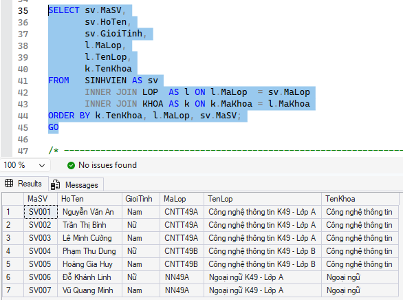
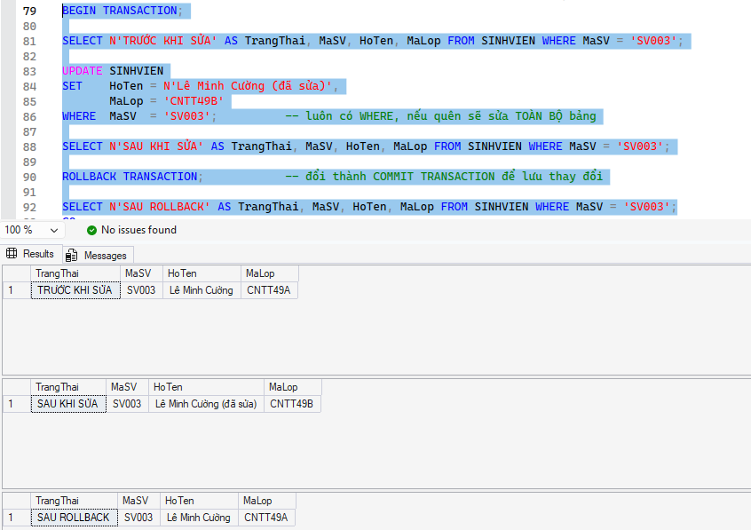
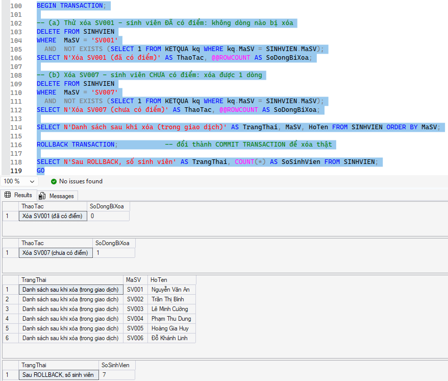
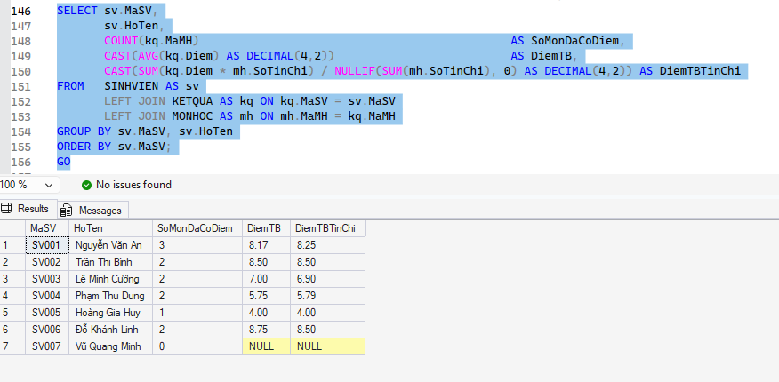
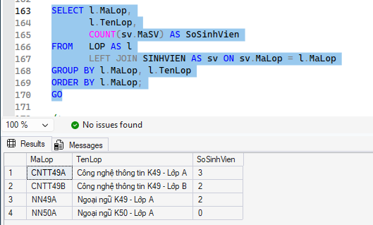
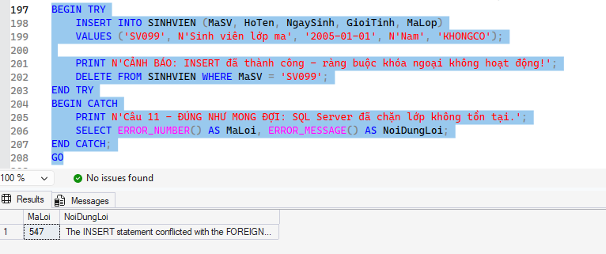
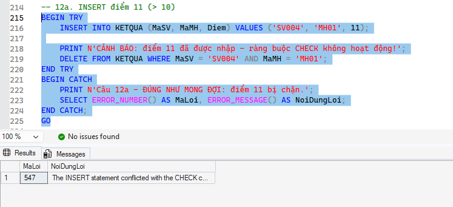
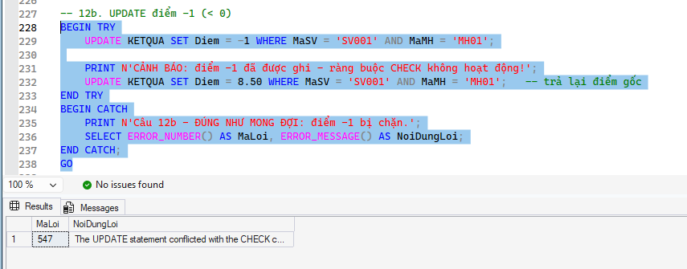

# BÁO CÁO NGẮN – BÀI LAB BUỔI 10: EduManagerDB (SQL Server)

## 1. Cấu trúc thư mục
| File | Nội dung |
|---|---|
| `01_CreateDatabase.sql` | Tạo database, 6 bảng, PK, FK, CHECK |
| `02_InsertSampleData.sql` | Dữ liệu mẫu: 2 khoa, 3 lớp, 7 sinh viên, 4 môn, 12 kết quả, 2 tài khoản |
| `03_Queries.sql` | 12 truy vấn yêu cầu + test ràng buộc |

## 2. Cách chạy
1. Mở SSMS, kết nối SQL Server.
2. Chạy lần lượt `01` → `02` → `03` (mỗi file chạy toàn bộ bằng F5).
3. File 01 tự đóng kết nối và `DROP DATABASE` cũ nên có thể chạy lại từ đầu.

## 3. Thiết kế (quan hệ giữa các bảng)
```
KHOA (1) ──< LOP (n) ──< SINHVIEN (n) ──< KETQUA >── (n) MONHOC
TAIKHOAN (độc lập, tài khoản demo)
```
- `LOP.MaKhoa` → `KHOA.MaKhoa`
- `SINHVIEN.MaLop` → `LOP.MaLop`
- `KETQUA(MaSV, MaMH)` là khóa chính kép; `MaSV` → `SINHVIEN`, `MaMH` → `MONHOC`

## 4. Ràng buộc đã cài
| Ràng buộc | Bảng.Cột |
|---|---|
| CHECK điểm 0..10 | `KETQUA.Diem` |
| CHECK giới tính IN (Nam, Nữ) | `SINHVIEN.GioiTinh` |
| CHECK số tín chỉ > 0 | `MONHOC.SoTinChi` |
| UNIQUE | `KHOA.TenKhoa`, `SINHVIEN.Email` |
| CHECK vai trò IN (Admin, User) | `TAIKHOAN.VaiTro` |

Mật khẩu trong `TAIKHOAN` được lưu dạng băm SHA-256, không lưu mật khẩu thô (chỉ phục vụ demo).

## 5. Kết quả mong đợi của một số truy vấn
**Liệt kê sinh viên kèm tên lớp và tên khoa**



**Cập nhật họ tên hoặc lớp của một sinh viên**



**Xóa một sinh viên chưa có dữ liệu điểm**



**Tính điểm trung bình của từng sinh viên**



**Thống kê số sinh viên theo từng lớp**



**Test lỗi khi thêm sinh viên vào lớp không tồn tại**



**Test lỗi khi thêm kết quả với điểm không hợp lệ**



