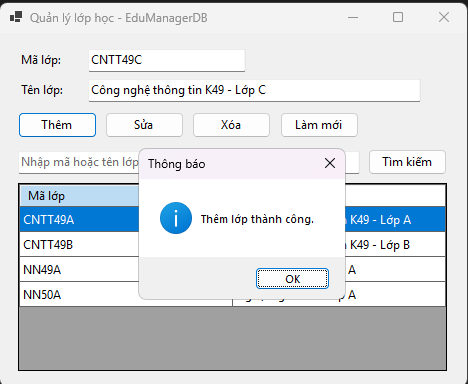
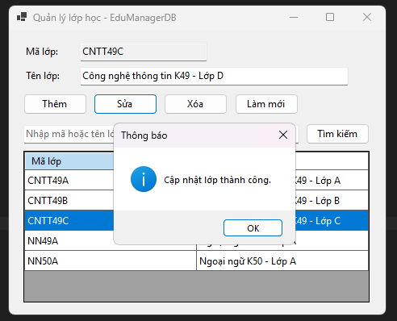
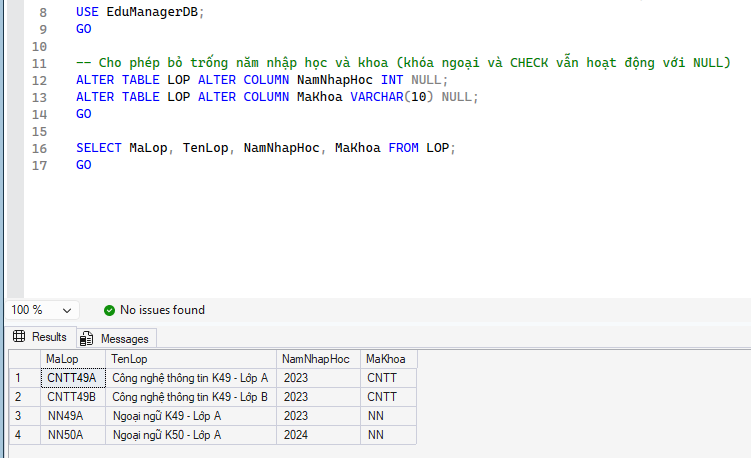
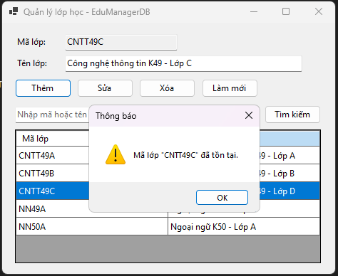
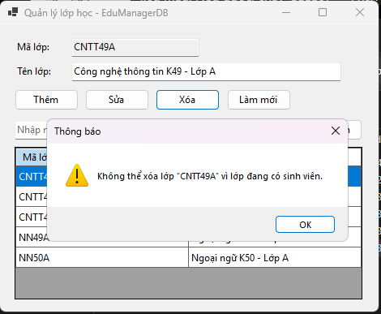

# COMP1019 - Lập trình trên Windows

## Lab 11 - Quản lý lớp học bằng ADO.NET và SQL Server

## 1. Giới thiệu

Bài lab xây dựng ứng dụng Windows Forms quản lý lớp học bằng C# và ADO.NET, kết nối với SQL Server thông qua thư viện `Microsoft.Data.SqlClient`.

Ứng dụng sử dụng database `EduManagerDB`, cho phép hiển thị, thêm, sửa, xóa và tìm kiếm lớp học. Dữ liệu được lưu trực tiếp trong SQL Server.

## 2. Công nghệ sử dụng

- C# Windows Forms, .NET.
- SQL Server và SQL Server Management Studio (SSMS).
- ADO.NET: `SqlConnection`, `SqlCommand`, `SqlParameter`.
- `DataGridView` để hiển thị danh sách lớp học.

## 3. Chức năng chính

| Chức năng | Mô tả |
|---|---|
| Hiển thị | Tải danh sách lớp từ SQL Server khi mở Form. |
| Thêm | Thêm lớp mới, kiểm tra dữ liệu trống và mã lớp trùng. |
| Sửa | Cập nhật tên lớp đã chọn. |
| Xóa | Xác nhận trước khi xóa, xử lý lỗi khóa ngoại. |
| Tìm kiếm | Tìm theo mã lớp hoặc tên lớp bằng `LIKE` và `SqlParameter`. |
| Làm mới | Xóa nội dung nhập và tải lại danh sách. |

## 4. Cơ sở dữ liệu

- **Database:** `EduManagerDB`
- **Bảng `LOP`:** `MaLop`, `TenLop`.
- **Bảng `SINHVIEN`:** `MaSV`, `HoTen`, `MaLop`.
- **Quan hệ:** `SINHVIEN.MaLop` là khóa ngoại tham chiếu `LOP.MaLop`.

File script tạo database và dữ liệu mẫu được lưu tại `Database/EduManagerDB.sql`.

Connection string đang được sử dụng trên máy cá nhân là:
ConnectionString =
            "Server=localhost\\SQLEXPRESS;Database=EduManagerDB;Integrated Security=True;TrustServerCertificate=True;";

## 5. Giao diện và kết quả

### Form quản lý lớp học

### Kết quả thêm, sửa hoặc tìm kiếm lớp

### Database và dữ liệu trong SQL Server

### Các lỗi thường gặp

## 6. Hướng dẫn chạy chương trình

1. Chạy script `Database/EduManagerDB.sql` trong SSMS.
2. Mở project bằng Visual Studio.
3. Cài package `Microsoft.Data.SqlClient` nếu chưa có.
4. Cấu hình connection string theo SQL Server trên máy cá nhân.
5. Chạy chương trình và kiểm tra các chức năng CRUD.

**Thông tin kết nối:**
- Database: `EduManagerDB`
- SQL Server instance: Ghi tên instance thực tế.
- Phương thức xác thực: Ghi Windows Authentication hoặc SQL Server Authentication.

## 7. Kết luận

Bài lab giúp sinh viên thực hành kết nối SQL Server bằng ADO.NET, hiển thị dữ liệu trên `DataGridView`, thực hiện CRUD bằng câu lệnh SQL có tham số và xử lý các lỗi dữ liệu thường gặp.