# COMP1019 - Lập trình trên Windows

## Lab 12 - Data Binding, Stored Procedure và Transaction

## 1. Giới thiệu

Xây dựng ứng dụng **Quản lý kết quả học tập** bằng C# Windows Forms, sử dụng ADO.NET kết nối SQL Server.

Ứng dụng cho phép chọn lớp, chọn môn học, hiển thị danh sách sinh viên, nhập điểm và lưu kết quả của nhiều sinh viên cùng lúc bằng Transaction.

## 2. Công nghệ sử dụng

- C# Windows Forms, .NET.
- SQL Server, SSMS.
- ADO.NET: `DataTable`, `SqlDataAdapter`, `BindingSource`.
- Stored Procedure và Transaction.
- `Microsoft.Data.SqlClient`.

## 3. Chức năng chính

| Chức năng | Mô tả |
|---|---|
| Tải dữ liệu | Load danh sách lớp và môn học vào ComboBox. |
| Hiển thị sinh viên | Hiển thị sinh viên theo lớp và môn học đã chọn. |
| Nhập điểm | Nhập và chỉnh sửa điểm, ghi chú trên DataGridView. |
| Kiểm tra dữ liệu | Điểm phải là số và nằm trong khoảng 0–10. |
| Lưu tất cả | Lưu nhiều kết quả học tập bằng Transaction. |
| Commit / Rollback | Lưu toàn bộ nếu thành công, hủy toàn bộ nếu xảy ra lỗi. |

## 4. Cơ sở dữ liệu

**Tên database:** `QLSinhVienLab12`

Các bảng sử dụng:

- `LOP`: Thông tin lớp học.
- `SINHVIEN`: Thông tin sinh viên.
- `MONHOC`: Thông tin môn học.
- `KETQUA`: Điểm và ghi chú của sinh viên.

Các Stored Procedure:

- `sp_Lop_GetAll`
- `sp_MonHoc_GetAll`
- `sp_KetQua_GetByLopMon`
- `sp_KetQua_Save`

File script SQL: `Database/QLSinhVienLab12.sql`.

## 5. Giao diện chương trình

Form chính: `FrmNhapDiemTheoLop`

| Control | Chức năng |
|---|---|
| `cboLop` | Chọn lớp học. |
| `cboMonHoc` | Chọn môn học. |
| `btnTaiDanhSach` | Tải danh sách sinh viên. |
| `dgvKetQua` | Hiển thị và nhập điểm, ghi chú. |
| `btnLuuTatCa` | Lưu toàn bộ kết quả. |
| `Label / StatusStrip` | Hiển thị trạng thái thao tác. |

## 6. Hình ảnh minh họa

### 6.1. Giao diện nhập điểm

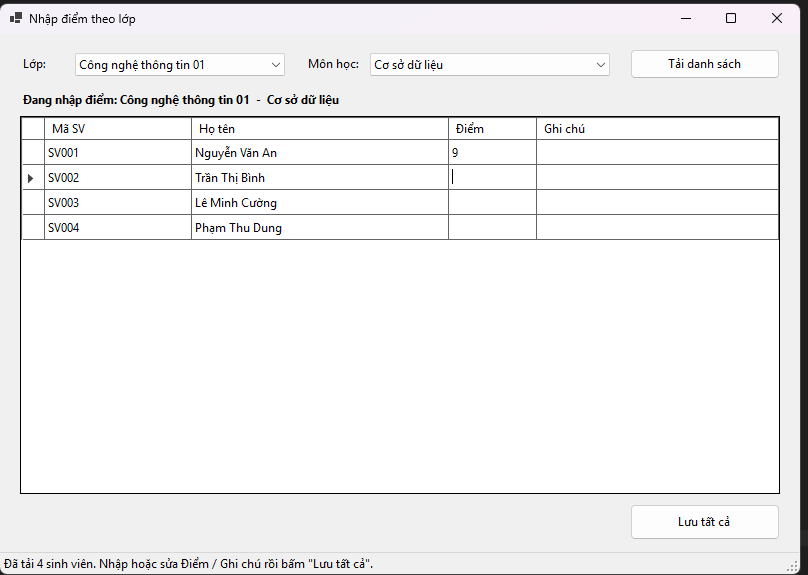

### 6.2. Danh sách sinh viên theo lớp và môn học

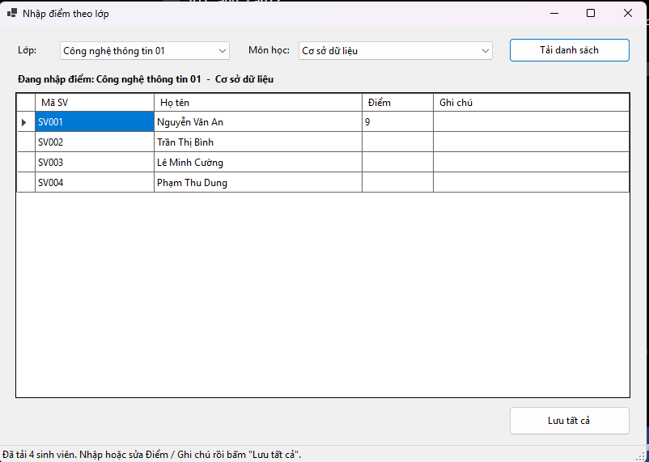

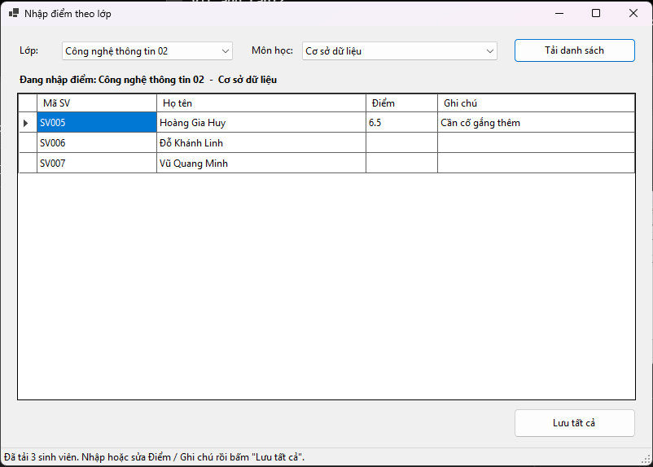

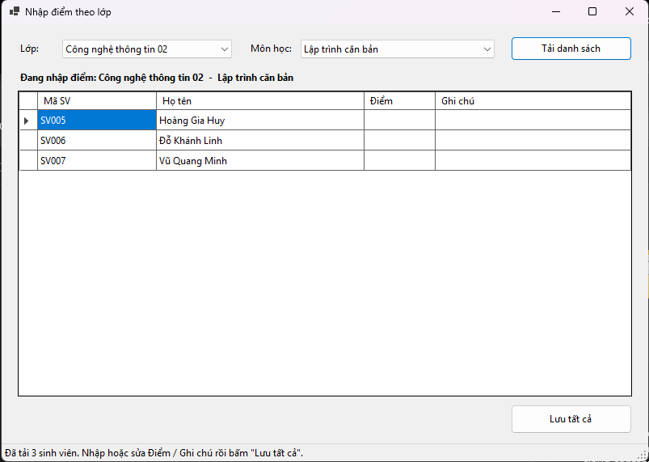

### 6.3. Kết quả lưu điểm thành công

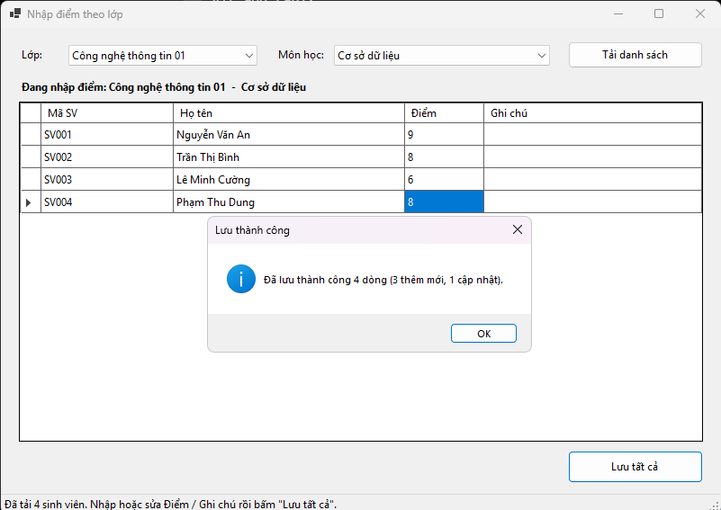

### 6.4.1. Thông báo lỗi 

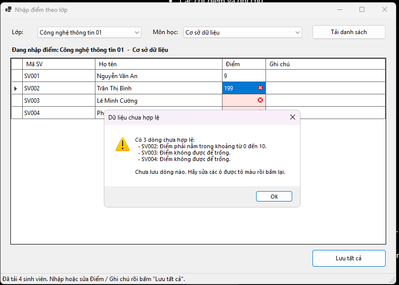

### 6.4.2. Rollback khi xảy ra lỗi

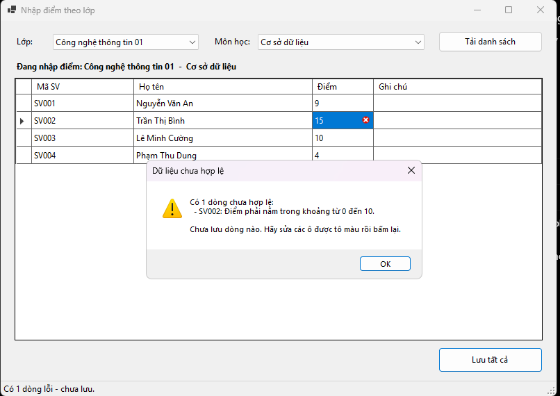

### 6.5. Database và Stored Procedure

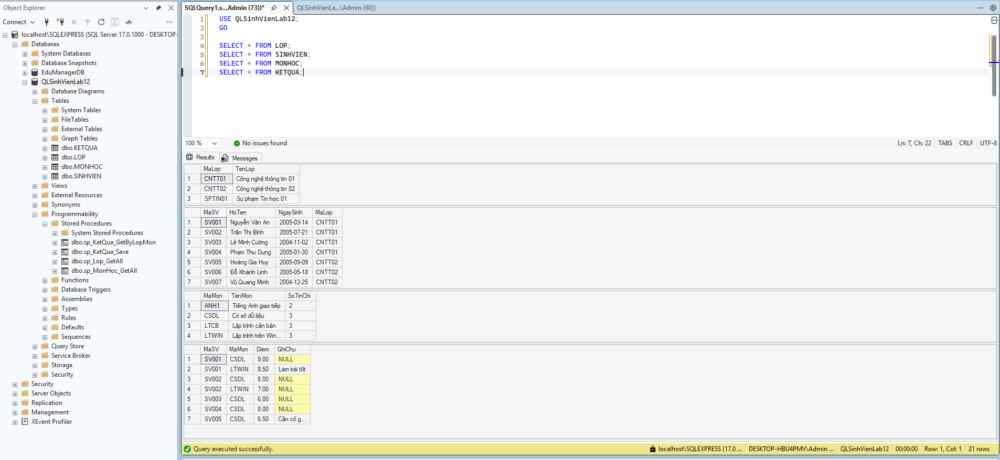

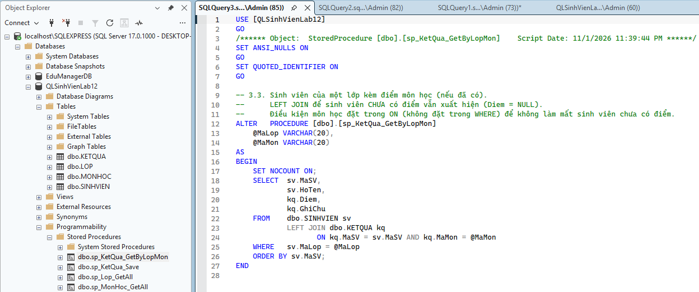

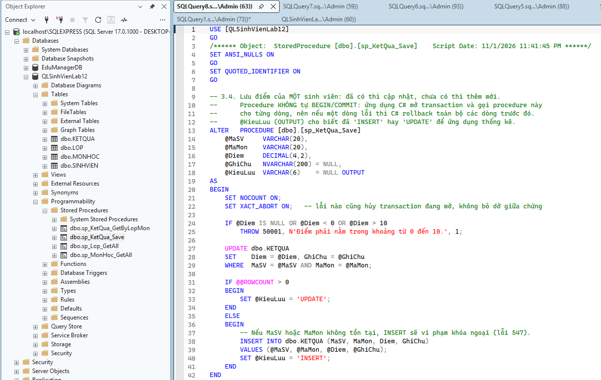

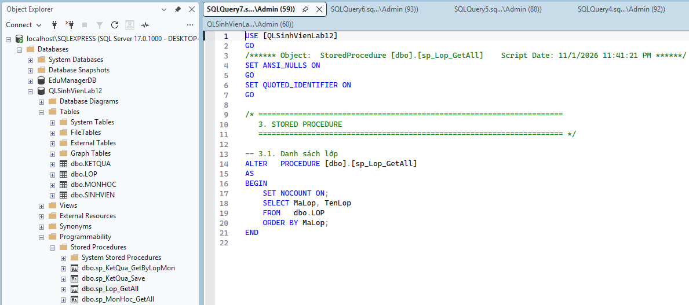

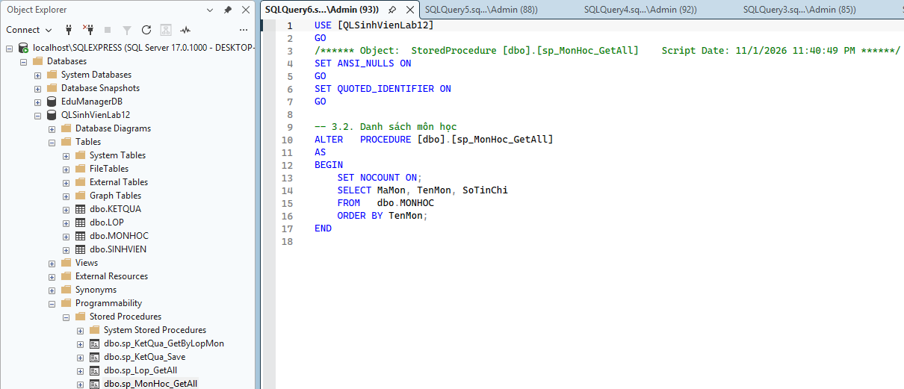

## 7. Cấu trúc project

```text
Lab12/
├── QLSinhVienLab12/
│   ├── Forms/
│   │   └── FrmNhapDiemTheoLop.cs
│   ├── DAL/
│   │   ├── Database.cs
│   │   └── KetQuaDAL.cs
│   └── Program.cs
│
├── Database/
│   └── QLSinhVienLab12.sql
│
├── images/
│   ├── form-nhap-diem.png
│   ├── danh-sach-sinh-vien.png
│   ├── luu-diem-thanh-cong.png
│   ├── rollback-loi.png
│   └── database-stored-procedure.png
│
└── README.md
```

## 8. Hướng dẫn chạy chương trình

1. Mở SSMS và chạy file `QLSinhVienLab12.sql`.
2. Mở project bằng Visual Studio.
3. Cài package `Microsoft.Data.SqlClient`.
4. Cấu hình connection string trong `Database.cs`.
5. Chạy chương trình bằng `F5` hoặc `Ctrl + F5`.
6. Chọn lớp, môn học, tải danh sách và nhập điểm để kiểm tra.

## 9. Kết luận

Bài lab giúp sinh viên thực hành Data Binding, Stored Procedure và Transaction trong C# WinForms. Qua đó, hiểu cách liên kết dữ liệu với giao diện và bảo đảm tính toàn vẹn khi lưu nhiều kết quả học tập cùng lúc.