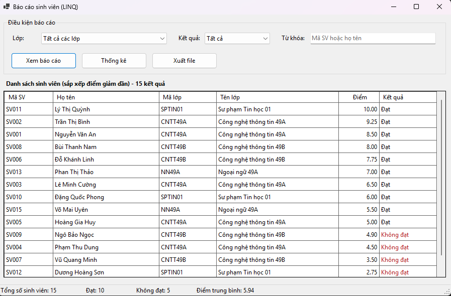
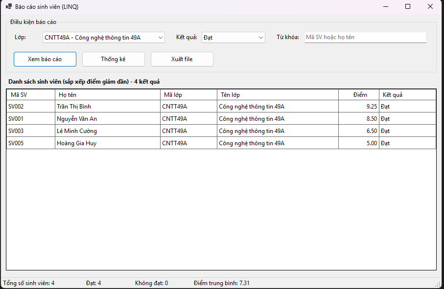
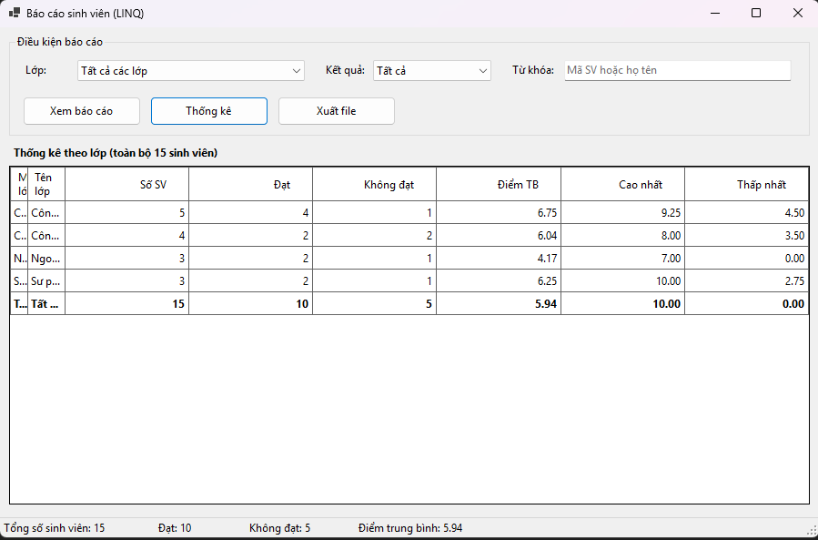
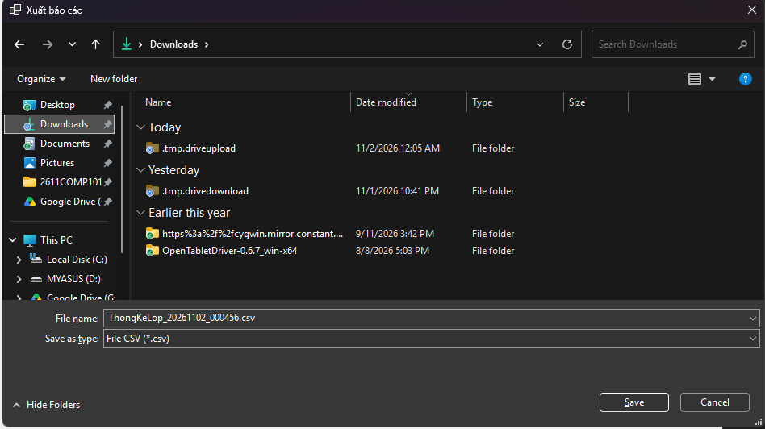
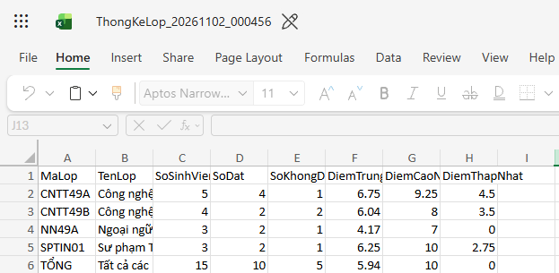

# COMP1019 - Lập trình trên Windows

## Lab 13 - Báo cáo sinh viên bằng LINQ

### 1. Giới thiệu

Xây dựng ứng dụng Windows Forms quản lý và báo cáo danh sách sinh viên theo lớp. Chương trình sử dụng LINQ để lọc, sắp xếp, thống kê dữ liệu và hỗ trợ xuất báo cáo ra file CSV hoặc TXT.

### 2. Công nghệ sử dụng

- C#: Windows Forms
- LINQ: Lọc, sắp xếp, nhóm và thống kê dữ liệu
- DataGridView: Hiển thị báo cáo
- SaveFileDialog: Lưu file CSV/TXT

### 3. Chức năng chính

- Chọn lớp và kết quả học tập: Tất cả, Đạt, Không đạt.
- Tìm kiếm sinh viên theo mã hoặc họ tên.
- Lọc và sắp xếp sinh viên giảm dần theo điểm.
- Thống kê số lượng sinh viên và điểm trung bình theo lớp.
- Xuất dữ liệu báo cáo ra file CSV hoặc TXT.
- Thông báo khi không có dữ liệu phù hợp và xử lý lỗi khi xuất file.

### 4. Giao diện chương trình

**Giao diện báo cáo sinh viên**

**Kết quả lọc và tìm kiếm**

**Thống kê sinh viên theo lớp**

**Kết quả xuất file báo cáo**

### 5. Kết luận

Hoàn thành Lab13, vận dụng LINQ để lọc, sắp xếp, nhóm và thống kê dữ liệu sinh viên; đồng thời thực hành hiển thị báo cáo trên DataGridView và xuất dữ liệu ra file.